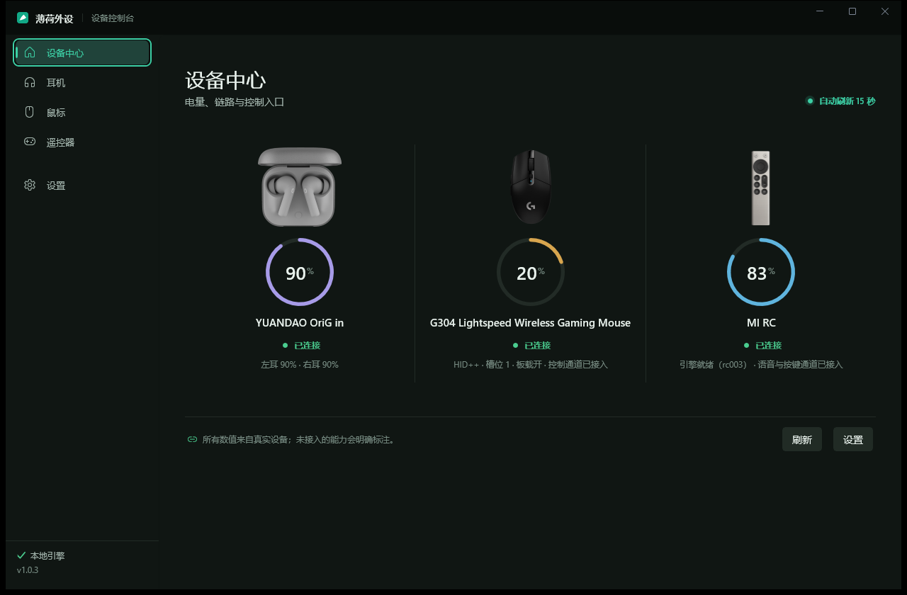
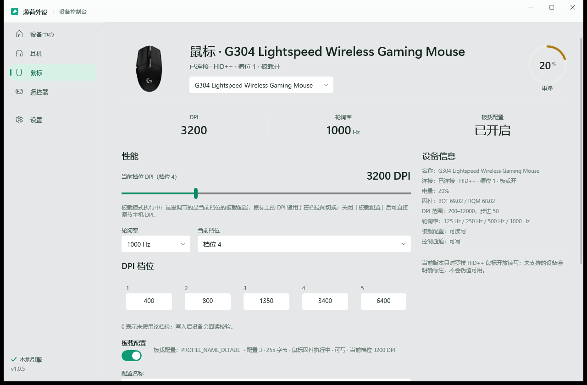
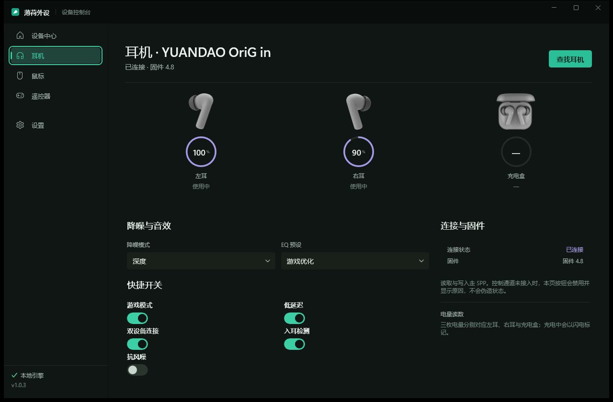
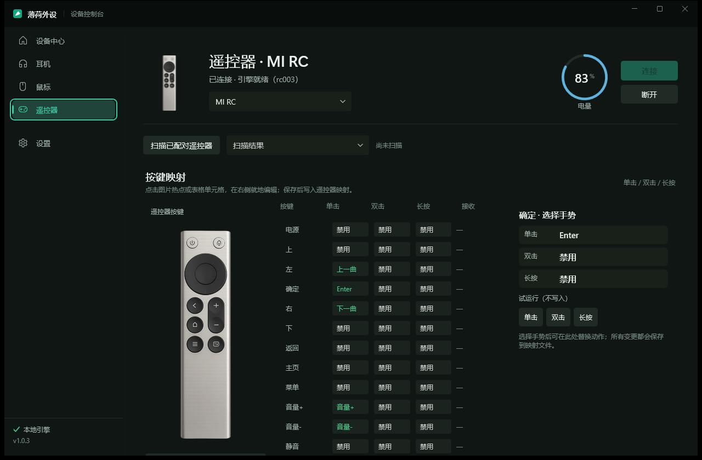
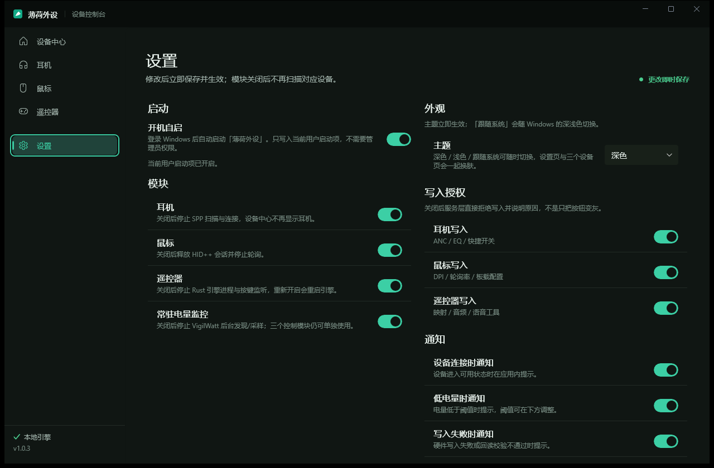
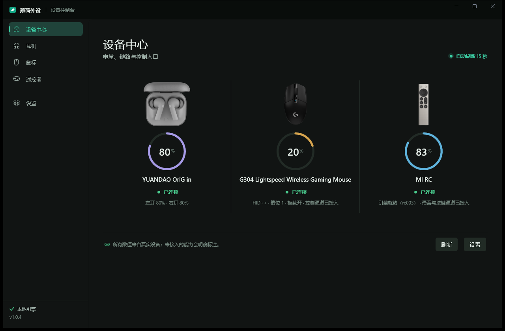

<div align="center">


# 薄荷外设 · Mint Peripherals

**把散落各处的蓝牙外设，收进同一扇窗。**

耳机调音、鼠标调档、遥控映射、电量值守——一台 Windows 设备上的外设控制台，
原生 WinUI 3，不塞浏览器内核，不画假数据。

[](https://github.com/Fat-kevin/mint-peripherals/releases)
[](LICENSE)
[](https://github.com/Fat-kevin/mint-peripherals/releases)
[](src)
[](src/DeviceCenterPreview.App)

[下载安装](#-安装) · [功能亮点](#-亮点) · [界面](#-界面) · [支持的设备](#-支持的设备) · [从源码构建](#-从源码构建) · [开源协议](#-开源协议)

</div>

---

## ✨ 亮点

**🌿 真·设备真·协议** —— 不模拟、不缓存造假：耳机走 SPP 串口协议、鼠标走罗技 HID++、遥控器走自研 Rust 引擎，每一颗电量数字都来自真实回包。写入必须"先读 → 写 → 回读校验"，失败就说失败。

**🎨 Mint Studio 设计语言** —— 雾白薄荷画布、呼吸状态点、无边胶囊开关、零外框布局。深浅双主题，外加**壁纸染色**：像 Mica 一样让界面透出你桌面的颜色，但没有实时合成的开销与崩溃风险。

**🔔 常驻不打扰** —— 最小化到托盘继续值守，连接提醒、低电量提醒、写入失败提醒一个不少。想关哪个，设置页一键关。

**🧱 稳定是纪律，不是口号** —— 固定窗口杜绝 resize 崩溃、页面内编辑取代弹层、15 秒刷新只改文本不重建控件。每一类黑屏触发点都有[档案可查](docs/stability/crash-history.md)，踩过的坑不再踩第二次。

**🚀 装完即用** —— 安装包自带 .NET 8 运行时与全部依赖，按用户安装不需要管理员；升级直接双击覆盖，设置原地保留。

## 📸 界面

| 设备中心 | 鼠标 · HID++ |
|:---:|:---:|
|  |  |

| 耳机 · SPP | 遥控器 · rc003 |
|:---:|:---:|
|  |  |

| 设置 · 外观与授权 | 深色 + 壁纸染色 |
|:---:|:---:|
|  |  |

## 🎯 支持的设备

| 模块 | 已验证设备 | 能做什么 |
|---|---|---|
| 🎧 耳机 | YUANDAO OriG in | 双耳独立电量、ANC 模式、EQ 预设、查找耳机、静默写入开关 |
| 🖱️ 鼠标 | 罗技 G304 / G305 | DPI 五档位、板载配置读写（含轮询率/按键映射）、主机/板载模式切换 |
| 🎮 遥控器 | 小米遥控器（MI RC） | 语音通道、按键映射、音量键/返回键系统级注入 |
| 🔋 电量 | 以上全部 | 常驻监控、连接/低电提醒、托盘速览 |

> 未验证型号会**明确标注只读**，绝不假装可写。当前写入仅对罗技 HID++ 已验证型号开放。

## 📦 安装

1. 到 [Releases](https://github.com/Fat-kevin/mint-peripherals/releases) 下载最新的 `DeviceCenterPreview-Setup-x.x.x.exe`（约 83 MB，自包含运行时）
2. 双击安装——按用户安装，不需要管理员；安装中会弹一次 UAC，用于注册遥控器音量键/返回键的辅助任务
3. 装完直接启动；**旧版本升级直接双击覆盖**，主题、映射、开关全部原地保留

<details>
<summary>安装时可能遇到的提示</summary>

- **SmartScreen「未知发布者」**：本地构建未签名，点「更多信息 → 仍要运行」
- 首次启动若提示未发现鼠标：动一动鼠标再点「刷新鼠标」（罗技接收器休眠唤醒）
</details>

## 🔧 从源码构建

```powershell
# 需要 .NET 8 SDK + Windows App SDK 1.7；必须 x64
dotnet build src/DeviceCenterPreview.App/DeviceCenterPreview.App.csproj -c Debug -p:Platform=x64

# 跑测试
dotnet test tests/DeviceCenterPreview.Core.Tests/DeviceCenterPreview.Core.Tests.csproj

# 打安装包（Inno Setup 6 + 自包含发布）
dotnet publish src/DeviceCenterPreview.App/DeviceCenterPreview.App.csproj `
  -c Release -p:Platform=x64 -r win-x64 --self-contained true -o publish/app
& "$env:LOCALAPPDATA\Programs\Inno Setup 6\ISCC.exe" installer/DeviceCenterPreview.iss
```

遥控器功能需要 Rust 工具链构建 sidecar：`cargo build --manifest-path sidecars/sayall-engine/Cargo.toml`

## 🗂️ 项目结构

```
src/DeviceCenterPreview.Core   # 模型 / 设置存储 / 协议契约（无 UI 依赖）
src/DeviceCenterPreview.App    # WinUI 3 界面 / 真实设备服务
external/                      # 自包含依赖源码（耳机控制栈）
sidecars/sayall-engine/        # Rust 遥控器引擎
vendor/rc003-helper/           # GPL-3.0 音量键辅助（独立进程随包分发）
installer/                     # Inno Setup 脚本
docs/                          # 渐进式文档：功能 / 协议 / 稳定性档案 / 决策记录
```

## 🤝 开源协议

本项目代码以 [MIT](LICENSE) 协议开源。

随安装包分发的 `rc003-helper`（音量键/返回键辅助）是独立进程，以
[GPL-3.0](vendor/rc003-helper/LICENSE) 协议随包分发，源码与许可声明保留在
`vendor/rc003-helper/`。本应用与其通过命令行参数交互，不产生代码级链接。

---

<div align="center">

**薄荷外设** · WinUI 3 / .NET 8 / Rust · 为爱发电的个人工具

⭐ 如果它管住了你的外设，欢迎点个 Star

</div>
