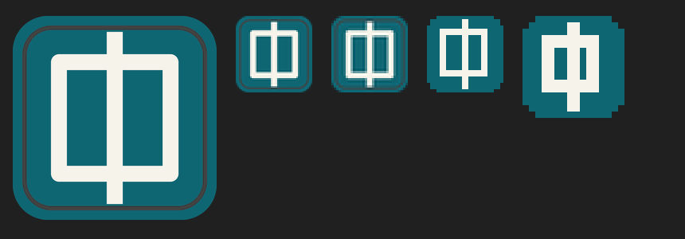
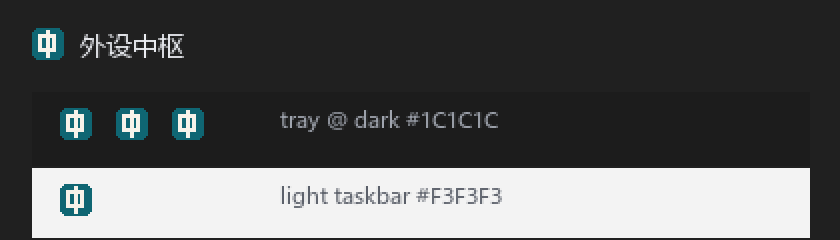

# 外设中枢 UI 视觉重构提案

> 范围：只做 UI/UX、资源字典、控件样式、公共组件和图标设计；不改 `IPeripheralService`、设备服务、Rust sidecar 或页面导航机制。
> 当前代码仍是“原生默认 Fluent”，本文件是下一轮实现的唯一视觉基线。实施时再同步更新 `docs/ui/design-system.md` 和 `.dsh/skills/winui-device-console/SKILL.md` 的 token。

## 0. 一句话结论

把现在的“控件堆叠的工程工具”改成 **Graphite Signal Desk（石墨信号台）**：哑光石墨分层、暖象牙主操作、每台设备一条信号色、左侧固定导航、每页一个主任务。技术上以 WinUI 3 原生控件 + 一套自己的 ResourceDictionary 为主；Windows Community Toolkit 只在设置页按需使用；图标用 Fluent System Icons，但设备身份用自绘几何与产品图，不用“三件套拼贴”。

---

## 1. 调研结论

### 1.1 适合引入 / 只参考 / 自己做

| 方向 | 结论 | 对当前项目的判断 |
|---|---|---|
| Windows Community Toolkit `CommunityToolkit.WinUI.Controls.SettingsControls` | **唯一可选引入：SettingsCard only** | 固定 **8.2.251219**。它的 net8 依赖是 WASDK `1.6.250108002`，低于当前直接引用的 `1.7.260224002`，NuGet 会取 1.7，不会降级。`SettingsCard` 是纯 ControlTemplate，没有 Popup/Flyout/ItemsRepeater/ItemsSource，适合缓存页；`SettingsExpander` 内部包 Expander + ItemsRepeater + 代码 applied clip，风险高，**本次不用**。注意：SettingsCard 的 Background/BorderBrush 由模板内的 StaticResource 别名驱动，不要逐实例设 Background；通过 Fluent palette key 覆盖。8.3 preview 依赖 WASDK 1.8 的 split package，**绝对不要装**。 |
| Windows Community Toolkit `Segmented` | **只参考** | 适合 ANC 模式，但当前用 ComboBox 是为了避开缓存页 RadioButtons 的稳定性问题；Segmented 也涉及 ItemsRepeater/选择状态，不值得为视觉冒险。第一版继续用重绘 ComboBox 或静态 ToggleButton 组。 |
| WinUICommunity / DevWinUI | **不引入，只参考** | WinUICommunity 7.1.0 的仓库最后提交是 2025-03-17，依赖 WASDK 1.6，基本停更；DevWinUI 10.8.0 依赖 `Microsoft.WindowsAppSDK.WinUI 2.2.1` + Win2D 1.4.0，会直接把你从 1.7 拖到 2.x。两者都不适合作为这个项目的地基。 |
| WinUIEx 2.9.x | **不引入** | 2.8.0 起依赖 `Microsoft.WindowsAppSDK.WinUI 1.8`；最后一个兼容 1.7 的是 2.7.0。它的价值在 WindowEx、backdrop、托盘等，当前项目已经有 `AppWindow`、自定义标题栏、托盘和胶囊，再引入既重复又改变已验证的窗口行为。Mica 也不需要它。 |
| WinUI 3 Gallery | **参考** | 不是组件库，是控件行为/视觉的对照表；用来确认 ToggleSwitch、ComboBox、NavigationView 的真实状态。 |
| WinUI.TableView 1.5.x | **不引入** | 适合动态数据表格；遥控器映射是固定的 13×3 静态单元格，现有代码按静态行构建，换 TableView 会引入 ItemsSource 重建、滚动嵌套和新的可访问性成本，违背稳定性约束。 |
| Fluent UI System Icons | **只取 16px SVG 几何** | MIT；仓库有 16/20/24/32/48 的分尺寸 SVG master，但没有官方 WinUI/XAML 包。把需要的 16px path 直接放进 `PathIcon`，矢量、零依赖、Win10 不会 tofu；**不要打包 `FluentSystemIcons-Regular.ttf`**，单字体缩到 12–16px 会发虚。 |
| Segoe Fluent Icons / MDL2 | **系统字体，保持默认 FontIcon** | Win11 用 Segoe Fluent Icons，Win10 自动回退 MDL2；`Microsoft.ui.xaml.dll` 里就是 `Segoe Fluent Icons,Segoe MDL2 Assets` 的逗号回退，**不要写死 `FontFamily="Segoe Fluent Icons"`**，也不要分发 .ttf。当前 5 个导航 glyph 在 MDL2 都存在；遥控器的 `E8B8` 实际是 Webcam，这是语义 bug，必须换码点。 |
| WinUI 3 ResourceDictionary / ThemeDictionaries / ControlTemplate | **核心** | 颜色、字号、圆角、间距、卡片、按钮、导航选中态都能纯 XAML 完成；这是本项目最划算的部分，不增加依赖。 |
| Mica / Acrylic | **默认不用** | 当前窗口是固定 1280×840、深色、卡片式信息密度；Mica 只在透明区域露出，桌面壁纸会破坏对比度。项目代码已经因为本机 GPU/WARP 合成开销把 `SystemBackdrop` 设为 `null`（MainWindow.xaml.cs:70-76），且 `Root.Background` 是不透明 brush，所以今天即使设 backdrop 也看不见；要启用必须同时清 root/page 背景，重新打开黑屏风险文件。建议保持纯色石墨；未来只把 Mica Alt 作为“窗口背景外观”选项，且仅在 Win11 22H2+ 且性能过关时启用。 |

### 1.2 推荐技术路线

```text
WinUI 3 原生控件
  + 自己的 Tokens/Controls/Cards/Navigation ResourceDictionary
  + 少量 UserControl（PageHeader / SectionCard / StatusChip / SettingRow）
  + 系统 Segoe Fluent Icons（默认 FontIcon；需要特殊语义时用 16px SVG PathIcon）
  + 现有设备 PNG（产品图，不重画）
  + 可选：SettingsPage 使用 WCT `SettingsCard`（仅 8.2.251219）
  - 不引入 WebView / HTML / Electron / Tauri
  - 不引入完整 MVVM / Prism / ReactiveUI
  - 不引入第三方表格/图表/主题套件
```

为什么不是“直接上 WCT 全家桶”：当前页面是 code-behind + 命名元素更新，WCT 的 SettingsCard 只是视觉容器，不会帮你解决信息层级；而 WinUICommunity/DevWinUI 会带来一整套风格，和“每台设备一条信号色”的定制方向冲突。先把 token 和卡片层级做好，比换库收益大。

版本底线：当前 `1.7.260224002` 是 1.7 的最后一个稳定补丁；1.8 已到 `1.8.260921001`，2.x 已到 2.5.1。本次不要为了让某个包好装而升级 Windows App SDK；WCT 只允许 **8.2.251219**，因为 8.3 preview 依赖 1.8 的 split package。1.7 停止 servicing 是另一个独立迁移决策。

如果最终决定用 WCT，csproj 只加这一行：

```xml
<PackageReference Include="CommunityToolkit.WinUI.Controls.SettingsControls" Version="8.2.251219" />
```

不要加 `CommunityToolkit.WinUI.Media`（Win2D）、`Behaviors`（Xaml.Behaviors）、`Animations` 或 8.3 preview。

---

## 2. 当前 UI 问题审计

### 2.1 信息层级

- 最常用的 `AppCardFootnoteStyle` 是 11px（App.xaml:54-58），全项目约 30 处；11px 被当成正文/说明，低于本项目 12px 可读性下限。
- 设备中心卡片里设备名 14px SemiBold，电量 26px Bold（DeviceCenterPage.xaml:68-85），身份比读数弱；用户先看到“100%”，再看“这是什么设备”。
- 页面标题 24px，但卡片标题 14px、区块标题 15px；三级层级差距小，且没有“页面主操作”。
- 状态被重复编码：绿点 + “已连接” + 绿色 chip 背景 + 电量数字 + 电量条；信息多但决策信息少。
- 反馈文本（保存、查找、扫描、错误）被塞进 11px 的 `AppCardFootnoteStyle`，且经常放在页面底部或横向 StackPanel 里，用户看不到。

### 2.2 布局结构

- 5 个页面共用同一个 `ScrollViewer > StackPanel Padding="24,20" Spacing="20" MaxWidth="1120"` 骨架（DeviceCenterPage.xaml:7-11 等）；`MaxWidth=1120` 永远不生效，因为内容区只有 1100px（1280−180 导航）；页面实际上贴边，只有 24px 内边距。
- 设备中心三张 210px 高的卡片只占约 310px，下面约 480px 是空白；卡片宽而扁，像三个状态块，不是 dashboard。
- 耳机页三张 186px 的电量卡占满首屏，ANC/EQ 和快捷开关被推到 840px 折叠线以下；一张大卡片里塞了两个 section（HeadsetPage.xaml:124-192）。
- 鼠标页性能卡是一个 16px 间距的纵向表单：滑杆、下拉、5 个全宽 TextBox、档位、板载、配置名全堆在一起（MousePage.xaml:95-216）。
- 遥控器页工具栏是单行水平 StackPanel，`ScanButton + ScanCombo(260) + Connect + Disconnect + ScanStatus` 超出 1100px，状态文本被裁切（RemotePage.xaml:43-51）。
- 设置页是 6 张同权重的长卡片，约 1100px 连续滚动，没有分组/主次。
- 3 个页面还留着不会执行的 responsive 代码（DeviceCenter .cs:29-76、Headset .cs:27-94、Mouse .cs:90-133），既误导又增加维护成本。

### 2.3 卡片样式

- 全项目只有 `AppCardStyle`（14px 圆角、默认 Fluent 卡片底/描边）和 `AppKpiCardStyle`/`AppInnerPanelStyle`；没有 Hero、Section、Setting Row、Device Card 的区分。
- 约 19 个 `Border` 手写 `Padding="18,16"`；耳机页电量卡、鼠标页图片框、顶部 chip 都复用同一套 `AppKpiCardStyle`，语义混乱。
- 设备中心整张卡是一个透明 `Button` 包一个 `Border`，hover/pressed 只有在卡片后面透出的默认按钮底色；卡片本身没有边框变亮、按压缩放或焦点环。
- “进入控制 →”是 `TextBlock` 里的字面箭头（DeviceCenterPage.xaml:92-93），不是按钮，也不是图标；最该像按钮的地方最不像按钮。
- 卡片内再套 `AppInnerPanelStyle`，层级最多两层但没有“抬升面/内嵌面”的明确规则。

### 2.4 控件样式

- 18 个 `ToggleSwitch` 几乎全是默认 `Header=` 形式；设置页 11 个开关每个后面再跟一个 11px 说明，标签和说明分离。
- 27 个 XAML `ComboBox`、6 个 `TextBox`、2 个 `Slider`、1 个 `HyperlinkButton`，全部默认 Fluent；没有主按钮、危险按钮、次级按钮的区分。
- 鼠标页 16 个按键映射 ComboBox 用同一个默认外观，页面主要视觉纹理变成“下拉框墙”。
- 遥控器映射表 39 个单元格按钮是 11px、8,4 padding（RemotePage.xaml.cs:717-726）；文字低于最小字号，禁用态是一整片灰色。
- 设置页的“恢复默认设置”只有 arm-to-confirm 文案变化，没有危险色/危险边框；虽然保留 4 秒确认逻辑是对的，但视觉上不够清楚。

### 2.5 导航样式

- `NavigationView` 180px 宽、默认 pane header/hamburger，没有分组标题、没有 PaneFooter、没有设备在线摘要；5 个 item 只占 250px，左栏近 500px 空白。
- 选中态使用系统 Accent；当前系统是紫色，导致左栏、标题竖条、ToggleSwitch 全部变成同一种紫，品牌感变成“默认主题”。
- `InfoBar` 的左边距 196 与页面内容 204 差 8px（MainWindow.xaml:65-71），宽约 1060px，覆盖标题；7 秒自动消失，长错误来不及读。
- 标题栏只有 16px 图标和 13px 应用名，没有页面上下文，也没有为右侧 caption buttons 预留视觉空间。

### 2.6 品牌感

- 品牌色没有定义；系统 Accent（紫）、硬编码 iOS 绿 `#34C759`、代码里的绿/红/琥珀、遥控器的 Windows 蓝 `#0078D4` 和琥珀 `#FAAA17` 并存。
- 三台设备没有身份色；耳机、鼠标、遥控器的卡片视觉完全同构。
- 当前图标是深蓝→青渐变圆角底 + 三个白色圆节点 + 青色中心环。它在 256px 像“网络共享/节点”，在 32px 三个节点和中心环开始糊；渐变和青色是通用科技素材，没有“设备控制”的语义。

### 2.7 色彩和对比度

- 没有 `RequestedTheme`，跟随系统；浅色系统下 `Root.Background` 变成浅色，但硬编码的绿点、白色文字/图形不一定跟着变。
- 11px tertiary 文本（`#6F7786` 附近）在深色卡片上对比不足；`AppCardFootnoteStyle` 同时承担说明、状态、错误三种语义。
- 状态色没有语义 token：成功是 iOS 绿，警告是代码里的 `#FAAA17`，危险是 `#EF5B5B`/`#F07167` 混用，断开是灰。
- ProgressBar 在 XAML 里声明 Accent，运行时又被代码按电量改成绿/橙/红（DeviceCenterPage.xaml.cs:154-169），声明和实际不一致。

### 2.8 可读性

- 11px 是主力辅助字号；遥控器单元格也是 11px。
- 状态文本放在横向 `StackPanel` 里，横向测量无限宽，`TextWrapping` 实际不生效；长错误会裁切（HeadsetPage.xaml:185-190、MousePage.xaml:453-459、RemotePage.xaml:44-51/218-223）。
- 电量数字、DPI、百分比没有统一使用等宽数字，刷新时数字宽度跳动。
- 深色下正文和次级文字层级不够，说明文字经常比标签还淡。

### 2.9 一致性

- 5 个页面有 3 种页头：accent 竖条、图片 + 标题、纯标题；页头高度、间距、动作位置都不同。
- 卡片 padding 有 18,16、14,10、12,6、10,5 四套；圆角 14/10/999；标题 24/15/14/13/12/11 六档。
- 0 个自定义 UserControl；每个页面复制粘贴卡片、chip、状态色和按钮行。
- 设置页没有 `Unloaded`，重置计时器每次新建而不释放；其他页面都做了退订。
- `AppCardStyle` 的默认 Fluent 背景在浅色/深色下都“能用”，但没有品牌；当前 UI 更像 WinUI Gallery 示例，而不是产品。

### 2.10 稳定性红线（设计必须绕开）

- 固定 1280×840，尺寸只在 `InitializeComponent` 前设置一次；设计内容区按 **1072×792**（导航 208，页面内容 1008×744）来排，不做运行时响应式重排。
- 不用 `Flyout` / `ContentDialog` / `StartBringIntoView` 做主交互。
- 缓存页不能引入 `NumberBox` / `RadioButtons`；DPI 档位继续用静态 `TextBox`，ANC/EQ 继续用 `ComboBox` 或静态按钮。
- 15s 刷新只改文本/数值；遥控器 1s 刷新只改文本/画刷，不重建控件树。
- 页面 `Unloaded` 必须退订、停表、恢复 mapping suspension；新组件不能偷偷持有事件。
- 当前关闭是隐藏到托盘，`AppWindow.Hide/Show` 在 crash-history 里曾记录为黑屏触发点；标题栏/导航改动后必须跑完整回归。

---

## 3. 设计方向定义

### 3.1 名称与关键词

**Graphite Signal Desk（石墨信号台）**

- 关键词：哑光石墨、仪器感、接口化、信号色、克制、可读、桌面控制台。
- 一句话气质：不是“Windows 设置页”，而是一台放在桌面上的小型设备控制台；三台外设像插在同一块背板上的三条通道，各有自己的信号灯。
- 参考对象：
  - **PowerToys**：工具密度与信息效率，不是视觉配色。
  - **Files**：左侧导航、内容区留白和列表层级。
  - **Windows 11 Settings**：设置行的语义（标题/说明/控件），但要去掉默认设置页的“白底卡片”味。
  - **Teenage Engineering / 音频硬件**：实体按键、哑光面板、信号灯、数字读数。
  - **NICEHCK / OpenMouse**：设备产品图、电量作为主角，但不照抄其 Web 布局。
- 明确不做：
  - 不做“深色 + 紫色渐变 + 大圆角玻璃卡片”的 SaaS dashboard。
  - 不做 RGB 游戏外设风、霓虹描边、发光阴影。
  - 不做“三张完全同构卡片 + 默认 ToggleSwitch 堆叠”。

### 3.2 深色主题策略

- 当前固定深色：`Root.RequestedTheme="Dark"`，`SystemBackdrop = null`，所有页面使用不透明石墨层。
- 不用 Mica/Acrylic 作为主要内容背景：桌面壁纸不可控，卡片对比度会被破坏；本机也有合成开销记录。
- 用 4 层不透明面 + 1px 边框 + 极弱顶部高光做层级，不用大阴影：
  1. 窗口底 `#131418`
  2. 导航/标题栏 `#0E1014` / `#0A0B0E`
  3. 卡片 `#1B1D23`
  4. 抬升面/输入 `#22252D` / `#1F2229`
- 光感只来自颜色和边框，不来自模糊；Hero 卡片允许一条非常弱的顶部高光/线性渐变，其他卡片纯色。

### 3.3 强调色策略

- **替换系统 Accent，而不是继续跟随它。** 系统 Accent 是用户桌面主题色，今天是紫色，明天可能是蓝色，产品没有稳定身份；同时紫色面积过大时像游戏/AI 模板。新方案把 **Ion Blue `#8FA6FF`** 固定为交互色，只用于焦点环、链接、选中态、进度/图表；**`#8B5CF6` 从全局主色降为旧 token，实施时同步改 `design-system.md` 和 skill**。
- 紫色只保留为耳机设备身份色，不作为全局品牌色；粉色完全退出 UI（不进入任何语义 token）。
- 主操作：**暖象牙 `#E9E2D4`**，深色文字；像硬件上的实体键，每页最多一个。它比紫色按钮更稳、更像设备控制台。
- 设备身份色（饱和度略降，避免 RGB 感）：
  - 耳机 `#B69CFF`（薰衣草）
  - 鼠标 `#F6B24A`（琥珀）
  - 遥控器 `#3DD6C4`（薄荷青）
- 颜色纪律：设备色只出现在信号条、图标底色、选中/状态、电量条；不铺满卡片，不用于正文。
- 语义色：成功 `#57D6A5`、警告 `#E6B25E`、危险 `#EF7B72`、离线 `#7C8594`。状态永远“颜色 + 文字/图标”，不能只靠颜色。

### 3.4 动效

- 只保留控件状态过渡：hover/pressed 120–160ms 颜色/边框变化；ToggleSwitch/ComboBox 使用系统动画。
- 不做页面入场、卡片逐个 fade-in、悬浮位移、数字滚动。
- 15s/1s 刷新不触发布局动画；只改文本和画刷。
- 焦点态用 2px Ion Blue 外描边，键盘可见；不能只靠变色。

---

## 4. WinUI 3 设计系统

### 4.1 色彩 token

| 语义 | Dark | 用途 |
|---|---|---|
| `AppCanvasBrush` | `#131418` | 窗口主背景 |
| `AppChromeBrush` | `#0E1014` | 导航面板 |
| `AppTitleBarBrush` | `#0A0B0E` | 自定义标题栏 |
| `AppCardBrush` | `#1B1D23` | 普通卡片/区块 |
| `AppRaisedBrush` | `#22252D` | Hero 内抬升面、重要子面板 |
| `AppInputBrush` | `#1F2229` | TextBox/ComboBox 背景 |
| `AppHoverBrush` | `#242833` | 行/卡片 hover |
| `AppPressedBrush` | `#2A2E39` | pressed |
| `AppSelectedBrush` | `#2C3240` | 选中行/导航项 |
| `AppBorderBrush` | `#2D313B` | 卡片/输入边框 |
| `AppBorderSubtleBrush` | `#242832` | 表格分割线、内层面板 |
| `AppTopHighlightBrush` | `#14FFFFFF` | 1px 顶部高光（仅 Hero） |
| `AppTextPrimaryBrush` | `#F5F7FB` | 标题/主文字 |
| `AppTextSecondaryBrush` | `#A3AAB8` | 说明/次文字 |
| `AppTextTertiaryBrush` | `#7C8594` | 元数据（≥12px） |
| `AppTextDisabledBrush` | `#5B6270` | 禁用（仍保留文字） |
| `AppIonBrush` | `#8FA6FF` | 焦点/链接/全局交互 |
| `AppIonHoverBrush` | `#A9B9FF` | Ion hover |
| `AppIonPressedBrush` | `#7188E8` | Ion pressed |
| `AppPrimaryFillBrush` | `#E9E2D4` | 主按钮 |
| `AppPrimaryFillHoverBrush` | `#F4EEE2` | 主按钮 hover |
| `AppPrimaryFillPressedBrush` | `#D9D0BF` | 主按钮 pressed |
| `AppPrimaryTextBrush` | `#17181C` | 主按钮文字 |
| `AppSuccessBrush` | `#57D6A5` | 已连接/成功 |
| `AppWarningBrush` | `#E6B25E` | 低电量/注意 |
| `AppDangerBrush` | `#EF7B72` | 失败/危险 |
| `AppOfflineBrush` | `#7C8594` | 离线/不可用 |
| `AppHeadsetBrush` | `#B69CFF` | 耳机身份/信号 |
| `AppMouseBrush` | `#F6B24A` | 鼠标身份/信号 |
| `AppRemoteBrush` | `#3DD6C4` | 遥控器身份/信号 |

对比度（对 `#1B1D23` 卡片）：主文字约 15.8:1、次文字约 8.8:1、三级文字约 5.5:1；Ion 约 7.4:1；设备色 7.7–9.8:1。`AppTextDisabledBrush` 约 2.9:1，只用于禁用，不用于说明。

浅色扩展先定义映射，不现在实现：

| 语义 | Light |
|---|---|
| Canvas | `#F4F5F8` |
| Card | `#FFFFFF` |
| Raised | `#F7F8FB` |
| Input | `#FFFFFF` |
| Border | `#DDE1E8` |
| Text primary | `#16181D` |
| Text secondary | `#596273` |
| Ion | `#4F63D8` |
| Primary action | `#1F232B`（深色按钮） |

### 4.2 圆角

| Token | 值 | 用途 |
|---|---|---|
| `RadiusInput` | 8 | 输入框、小 chip |
| `RadiusControl` | 10 | 按钮、可点行 |
| `RadiusM` | 12 | 内层面板、图标底座、设置行 |
| `RadiusL` | 16 | 普通卡片、区块卡 |
| `RadiusXL` | 20 | Hero 卡、产品图舞台 |
| `RadiusPill` | 999 | 状态胶囊/计数 badge |

### 4.3 间距

`4 / 8 / 12 / 16 / 24 / 32` 六档；页面左右 32、上下 24；区块间距 24；卡片间距 16；卡片内边距 24；Hero 内边距 24；内层面板 16；表格行高 36，紧凑行 32；导航项高 40。

**Shell 几何（固定窗口，不做运行时响应式）**：

```text
Window 1280×840
├─ TitleBar 48
└─ NavigationView 208 + Content 1072×792
   └─ Page padding 32,24 → 内容 1008×744
      ├─ PageHeader 约 64 + 24 间距
      ├─ 3 × DeviceCard 325，gap 16 → 1007（1px 取整）
      └─ 下方 QuickActions / LinkHealth
```

- 页面根 `ScrollViewer.HorizontalContentAlignment="Stretch"`，内容用 `Grid`/`StackPanel` 拉伸；`MaxWidth` 不再写 1120（无效值）。
- 如果 Phase 1 不改导航宽度，内容仍是 1100；卡片宽度按 `(内容宽 − 2×32 − 2×16) / 3` 算，不要写死 325。**先决定 nav 180→208，再定卡片宽**；不要在实现中两套混用。
- 现有页面用代码同步 `PageContent.Width = ViewportWidth` 的 workaround 先保留，等新布局在一页验证后再删；不要为了“干净”先改布局机制。
- `InfoBar` 左边距 = 208 + 32 = 240，宽 1008，放在页头下方或页面顶部，不要覆盖标题。
- 标题栏：48px 高，背景 `AppTitleBarBrush`，左侧 16px 图标 + 13px 应用名；不要放页面标题（页面已有 `PageHeader`）。`AppWindow.TitleBar.ButtonBackgroundColor` 用透明、`ButtonForegroundColor` 用 `#F5F7FB`、hover/pressed 用 `#242833`/`#2A2E39`；关闭按钮 hover 的红色保持系统，不要自绘。若 caption buttons 仍偏矮，才设 `PreferredHeightOption=Tall`，并只做一次回归。

### 4.4 字体层级

| 角色 | 字号/行高 | 字重 | 用途 |
|---|---|---|---|
| Page title | 30/36 | SemiBold | 页面唯一大标题 |
| Page subtitle | 14/22 | Regular | 设备名/状态/一句说明 |
| Hero name | 24/30 | SemiBold | 设备页主设备名 |
| Section title | 18/24 | SemiBold | 区块卡标题 |
| Card title | 15/20 | SemiBold | 设备卡/设置组标题 |
| Body | 14/22 | Regular | 正文、表格内容 |
| Meta | 12/16 | Regular | 说明、单位、辅助 |
| Numeric XL | 34/40 | SemiBold | 电量、核心读数 |
| Numeric L | 30/36 | SemiBold | DPI、次级读数 |
| Chip | 12/16 | Medium | 状态标签 |
| Nav | 13/20 | Regular | 左侧导航 |

字体：优先 `Segoe UI Variable Display`（标题）/ `Segoe UI Variable Text`（正文）；Win10 回退 `Segoe UI`，中文回退 `Microsoft YaHei UI`。不嵌入第三方字体。数字使用 `Typography.NumeralAlignment="Tabular"`（若当前 WinUI 版本不支持，则保留默认并固定数值容器宽度；不要为了数字引入 mono 字体）。最小字号 12，表格/元数据不再使用 11；12px 文本用 `#7C8594` 而不是 skill 里的 `#6F7786`，因为后者在卡片上低于 4.5:1。

### 4.5 控件视觉规范

| 控件 | 规范 |
|---|---|
| **Button** | 主按钮高 36、圆角 10、`AppPrimaryFillBrush`、深色 14px SemiBold 文字、左右 16 padding；Secondary：透明底、1px `AppBorderBrush`、14px；Tertiary：透明无边框、Ion 文字、12px；IconButton 32×32。每页最多一个主按钮；危险操作用 danger 文字/边框，不用红色实心大按钮。 |
| **HyperlinkButton** | 14px、Ion 色、无下划线、hover 变亮；只用于低频导航（打开目录），不替代主操作；不在链接文本后加 `→`。 |
| **ToggleSwitch** | 标签在外部 TextBlock，`Header` 不承载说明；`OnContent="开"`、`OffContent="关"`，轨道宽 40、高 20；开态 Ion/设备色，关态 `#3A3F4B`；禁用时轨道和文字都降低对比，不隐藏。 |
| **ComboBox** | 高 36、圆角 8、`AppInputBrush` 背景、`AppBorderBrush` 1px、12px 内边距；标签在外部 12px；下拉项 36px；不要用默认的 32px 紧凑感。 |
| **TextBox** | 高 36、圆角 8、输入背景；数值右对齐；聚焦 2px Ion 边框；错误用 danger 边框 + 下方 12px 文本，不弹 Flyout。 |
| **Slider** | 轨道 4px、 thumb 18px、Ion 色；值显示在右侧/上方 30px Numeric L；`IsThumbToolTipEnabled=True`；不把刻度标签塞进轨道。 |
| **InfoBadge / 状态标签** | 计数用原生 `InfoBadge`；状态用自定义 `StatusChip`：高 22–24、圆角 pill、6px 圆点 + 12px 文字 + 语义背景（alpha 12%）；必须带文字。 |
| **Card** | 普通卡 `RadiusL=16`、`AppCardBrush`、1px `AppBorderBrush`、padding 24；Hero `RadiusXL=20`、padding 24、顶部 1px 高光；不在卡内再套超过一层 `AppRaisedBrush`。 |
| **Section 容器** | `SectionCard`：标题 18 + 可选说明/右侧动作 + 内容；标题区高 48，内容区 padding 16；多个 Section 用 24 间距；不要每段都加一张独立卡。 |
| **列表/表格行** | 行高 36（紧凑 32）；14px 内容；底部 1px `AppBorderSubtleBrush`；hover `AppHoverBrush`；选中 `AppSelectedBrush` + 左侧 2px 设备/ Ion 条；不用每个单元格画边框。 |
| **NavigationView Item** | 高 40、左右 margin 8,2、圆角 8；图标 18、文字 13；hover `#1E222B`，选中 `#252A35` + 左侧 2px Ion + 图标 Ion；不要全圆角胶囊 + 阴影；分组标题 12px tertiary。 |

### 4.6 状态规范（不能只画“正常态”）

| 状态 | 视觉 | 文案 |
|---|---|---|
| **离线/未连接** | 设备卡图片 0.6 透明度；chip 灰点 + `AppOfflineBrush`；电量显示 `—`/“上次 92%” | “未连接”；CTA 仍是“打开”，进入后给“重新连接”，不要隐藏入口 |
| **电量未知** | 数字 `—`，不画假进度条；bar 只留 1px 轨道 | “电量未知” |
| **服务不可用** | 页面内 40px `StatusBanner`（Border，非 InfoBar 浮层），warning 左边框 + 14px 文字；不使用自动消失 | “设备服务未启动，页面只读；启动后重试” |
| **扫描中** | 按钮文字“扫描中…” + `IsEnabled=False`；状态行 12px | “正在扫描附近设备…” |
| **写入中/失败** | 主按钮下方 12px 行；失败用 danger 文字 + 具体原因，不弹 ContentDialog | “写入失败：设备未响应，请重试” |
| **未设置映射** | 表格 cell 用 tertiary 文字“未设置”，不写“—”/空白 | “未设置” |
| **0 台设备** | 首页仍显示 3 张设备卡（未连接），不出现整页空白；底部“扫描/连接” | “尚未发现设备” |
| **遥控器引擎未运行** | 连接条 warning chip；连接/扫描禁用并解释 | “引擎未运行，先启动 sidecar” |
| **禁用控件** | 保留文字，opacity 0.45 + 12px 原因；不能只靠变灰 | “需要连接后修改” |
| **busy** | 只改按钮文本/局部进度，不遮罩整页；不用无限旋转大图标 | “正在应用…” |

原则：状态必须“颜色 + 文字 + 位置”三者一致；离线和错误不能共用同一个灰色点；不能显示伪造数据或把禁用控件留成无解释的灰。

---

## 5. 各页面重构方案

### A. 设备中心首页（现代设备 dashboard）

**取舍**：保留“三张设备卡”，因为用户明确要“三张卡明显提升质感”；但在 1280 固定宽度下三列等宽（每张约 325px），下面用“快捷操作 + 链路健康”填满原来约 480px 的空白。不要改成三行横向通道（现有 mockup 的另一种方向），那会让首页更像列表，不符合“卡片 dashboard”的要求。

**版式**：

```text
标题栏 48
┌ 导航 208 ┬──────────────────────────────────────────────┐
│          │ PageHeader [◉] 设备中心        3/3 在线  刷新 │
│          │            耳机、鼠标、遥控器 · 最近同步 15s  │
│          │ ┌──────────┐ ┌──────────┐ ┌──────────┐      │
│          │ │ 设备卡    │ │ 设备卡    │ │ 设备卡    │      │
│          │ │ 325×360  │ │ 325×360  │ │ 325×360  │      │
│          │ └──────────┘ └──────────┘ └──────────┘      │
│          │ 快捷操作（3 个）           │ 链路健康         │
└──────────┴──────────────────────────────────────────────┘
```

**单张设备卡（统一骨架）**：

1. 顶部 4px 信号条/左侧 3px 信号条：耳机薰衣草、鼠标铜、遥控器薄荷；颜色只出现在这里和电量条。
2. 左上 88×88 产品图舞台：`AppRaisedBrush` + `RadiusM=12`，图 72×72 `Uniform`；不要白底、不要投影。
3. 右侧：设备名 15–16px SemiBold（最多 2 行），第二行 12px tertiary 写连接方式/型号；右上 `StatusChip`（已连接/离线）。
4. 电池区：34px Numeric XL + 小 `%`；下方 4px `BatteryBar`，低电量切 warning，未知显示 `—` 和“电量未知”，不画假条。
5. 关键指标：2–3 个 12px `Metric`（例如耳机“深度降噪 / 双设备开”，鼠标“1000 DPI / 1000 Hz”，遥控器“13 键 / 语音正常”）；用 `Border` 内嵌 chip，不用按钮。
6. 底部操作：整行 36px **Secondary Button**“打开控制”，右侧 16px chevron；这是卡片唯一 CTA，不要再用“进入控制 →”文字。整张卡可点，但按钮仍要有独立可访问名称；hover 时卡片边框变 `AppBorderStrong`（新增 `#3A4050`），焦点 2px Ion。
7. 卡片固定 `MinHeight=360`，三张严格对齐；设备图/文案区允许 2 行，指标区固定 1 行，底部对齐。

**页面下方**：

- 左 2fr：`快捷操作` 三枚 1/3 宽的 `QuickActionTile`（查找耳机、鼠标 DPI、接收测试），每枚 72px 高：图标 + 标题 + 一句 12px 说明；不是普通按钮堆。
- 右 1fr：`链路健康` 3 行（耳机 SPP / 鼠标 HID++ / 遥控器 Sidecar），每行左侧 6px 状态点 + 通道名 + 右侧“正常/未连接”；底部 12px 说明“未接入的能力会标注，不显示伪造数值”。
- 如果高度仍空，增加一条 40px 的“最近同步/设备摘要”条，不要增加第四张同构卡片。

**自适应**：当前固定 1280 不需要运行时换列。设计上给卡片 `MinWidth=300`；未来若解除固定窗口，三列低于 960 时改为 1 列，但**本次不实现**，也不要恢复已删除的 responsive 代码。

### B. 耳机页（消费电子控制中心）

**版式**：

```text
PageHeader [耳机图标] 耳机 / OriG in · SPP · 固件 1.0.8     [重新连接]
┌ Hero 1008×240 ───────────────────────────────────────────┐
│ [产品图 260×180]  设备电量  左 96% │ 右 100% │ 盒 100%   │
│                   [查找耳机]  5 秒倒计时/状态             │
└──────────────────────────────────────────────────────────┘
┌ 声音（约 640） ─────────────────────┐ ┌ 连接与设备（约 344） ─┐
│ 降噪模式 [深度 ▾]  EQ [均衡中正 ▾]  │ │ 已连接 / SPP / 固件    │
│ 快捷开关 2×3 tiles（5 个）           │ │ 型号/连接/电量 rows    │
│ 说明：开关状态来自耳机              │ │ [重新连接] [断开]      │
└─────────────────────────────────────┘ └────────────────────────┘
```

**关键改变**：

- 三张独立电量卡合并成 Hero 里的三枚 **BatteryPod**：每枚 28–30px 数字、12px 标签、3px 条/充电状态；产品图只出现一次，不再三张 104px 图重复。
- Hero 右侧固定“查找耳机”主按钮；按钮下方 12px 状态行承担倒计时/失败/成功，不再把反馈放到卡片底部 300px 外。
- “声音”拆成独立 `SectionCard`：ANC 和 EQ 为两个并排 `ControlField`（重绘 ComboBox，36px 高）；当前值用 15px Medium 显示在标签右边，避免用户必须展开才知道状态。
- 快捷开关改为 **SettingTile**：60–64px 高，左 32px 图标（Fluent 图标），中间 14px 标题 + 12px 说明，右侧无 Header 的 ToggleSwitch；2 列 × 3 行，空位放“连接状态”摘要，不留空格。
- “连接与设备”弱化为右侧辅助卡：顶部状态 chip，中间 `InfoRow`（型号、固件、连接方式、左右电量、充电盒），底部两个 Secondary 按钮；不要与声音区抢视觉。
- 语义修正：页头不再重复“已连接/固件”；标题只显示设备名，状态 chip 只出现一次。
- 保留 5 秒可取消查找；保留 `ComboBox` 的枚举顺序（数组顺序是协议，不在视觉重构中改顺序）。

### C. 鼠标页（专业外设控制台）

**版式**：

```text
PageHeader [鼠标图标] 鼠标 / G304 · HID++ · 板载开     [刷新]
┌ Hero 1008×220 ───────────────────────────────────────────┐
│ [产品图 160] G304 / Lightspeed    1350 DPI │ 1000 Hz │ 开 │
│              已连接 · HID++ · 低电量建议（warning chip）     │
└──────────────────────────────────────────────────────────┘
┌ 性能（2fr, 约 640） ───────────────────┐ ┌ 设备（1fr, 约 344） ┐
│ 当前 DPI  1350        [slider 全宽]      │ │ 型号/连接/电量 rows │
│ 轮询率 [1000 Hz ▾]                      │ │ 固件/范围/通道      │
│ DPI 档位 [1][2][3][4][5] 5 个 stage tile│ │ 板载配置/配置名     │
│ 当前档位 [档位 3 ▾]  板载 [开]           │ │ 写入状态说明        │
└─────────────────────────────────────────┘ └──────────────────────┘
┌ 按键映射（1008） 设备返回 6 个 ──────────────────────────┐
│ 左鍵 [左键点击 ▾]   右鍵 [右键点击 ▾]                     │
│ 中鍵 [中键点击 ▾]   后退 [后退 ▾]                         │
│ 前进 [前进 ▾]       DPI [DPI 切换 ▾]                      │
│ 说明 + [应用设置] [刷新鼠标]                              │
└──────────────────────────────────────────────────────────┘
```

**关键改变**：

- 顶部摘要从“图片 + 标题 + 三个 chip + 电量小胶囊”改成 **紧凑 Hero**：图片 150–160，右侧三列 `MetricBlock`（DPI 30px、轮询 24px、板载 24px），低电量用一行 warning chip，不单独占卡。
- 性能卡分成两个明确区块：`当前 DPI`（大数字 + 滑杆）和 `档位编辑`（5 个横向 StageTile）。每个 StageTile 是 96×64：上方“档位 1”12px，下方 TextBox 18px 右对齐、无边框、居中；选中档位用 2px 鼠标铜边框 + 轻微 `AppRaisedBrush`。五个并排，取代 5 行全宽 TextBox。
- 当前档位 + 板载开关放在 Stage 区底部同一行；配置名放在设备卡，不再混在性能卡。
- 设备信息卡改成 `InfoRow` 键值行（12px），标题小、行距紧；设备名只出现在 Hero，不在信息卡重复。
- 按键映射：2 列 × 最多 8 行，每个 row 36px：左侧 12px 键名，右侧重绘 ComboBox；不要嵌套 `ScrollViewer MaxHeight=140`，因为会偷走页面滚轮。多出的按键用页面自然滚动，或分成“主按键/侧键”两段；保留 16 个静态 ComboBox 和一次设置的 ItemsSource。
- 应用按钮：`应用设置` 主按钮（象牙），`刷新鼠标` Secondary；`SaveStatus` 移到按钮右侧，用 12px 语义色，不再在页面最底部。
- 低电量写入提示紧邻主按钮，不要只放在 Hero 最右边。

### D. 遥控器页（配置控制台）

**版式**：

```text
PageHeader [遥控器图标] 遥控器 / MI RC · 89% · 引擎运行中   [刷新]
┌ 连接条 1008×64 ──────────────────────────────────────────┐
│ [设备 MI RC ▾]  [引擎运行中]   [扫描] [连接] [断开]       │
└──────────────────────────────────────────────────────────┘
┌ 按键图 240 ┐ ┌ 当前按键（约 420） ┐ ┌ 语音链路 300 ┐
│ 产品图     │ │ 确定  · 3 个手势   │ │ 音频端点      │
│ 热区       │ │ 单击 [确定] 修改    │ │ 语音工具      │
│ 13 键      │ │ 双击 [播放/暂停] 修改│ │ 增益 [slider]  │
│ 接收测试   │ │ 长按 [未设置] 分配  │ │ 全按键 [开]   │
│ 状态       │ │ [单击][双击][长按]  │ │ 打开声音设置  │
└────────────┘ └────────────────────┘ └───────────────┘
┌ 全部映射 13 键 / 39 个映射 [全部] [已设置] [未设置] ─────┐
│ 按键   单击        双击        长按        接收          │
│ 电源   长按关机    禁用        禁用        —             │
│ 上     方向上      禁用        禁用        —             │
│ …                                                       │
└──────────────────────────────────────────────────────────┘
```

**关键改变**：

- 顶部“标题 + 设备 combo + 电量 + 扫描工具栏”拆成 **PageHeader + 一条 64px 连接条**；连接条内设备选择、引擎状态、扫描/连接/断开按主次排列，状态文本换行放到第二行或 ToolTip，不再横向溢出。
- 主工作区三列：左 240 图片卡、中 1fr 当前按键卡、右 300 语音卡；产品图 `Stretch=Uniform`，不要 `Stretch=Fill` 拉变形；热区仍用透明 Button，选中态用 2px 琥珀/设备色 + 文字“已选”，不要只改标题。
- 当前按键卡：大标题 20–24px；三个手势行 48px，每行“手势名 12px / 当前动作 14px / 修改 Secondary 按钮”；底部三个测试按钮作为一组（不是三个同等默认按钮）。
- 语音卡拆成三个逻辑块：端点/工具（重绘 ComboBox）、增益（slider + 数值 + 应用按钮在 slider 右侧）、全按键/状态（ToggleSwitch + 12px 说明）。`应用增益` 紧邻 slider，不放到页面底部。
- 全部映射：静态表头 12px，行高 36px；不要给每个 cell 画边框，只用行底线；单元格是“文字 + 小 chevron”的 Tertiary Button，选中行 `AppSelectedBrush` + 左 2px 设备色；已配置/未配置用文字 + 颜色双编码。
- 编辑器：当前 `ActionEditorCard` 在右侧顶部 + `ChangeView(null,0)` 会跳到页面顶部；重构时把它固定在 **当前按键卡顶部的一个 56–180px 槽位**，或者让点击手势后只在当前行展开。不要用 Flyout。若保留 `ChangeView`，只滚到映射卡顶部，不滚到页面 0。
- 表格列宽只保留一个来源：XAML 表头和 code-built rows 使用同一组常量（例如 `RemoteTableMetrics` 静态类），不要手写两套 76/*/*/*/64。

### E. 设置页（系统级设置中心）

**版式**：

```text
PageHeader [设置图标] 设置 / 修改后立即保存，模块关闭后停止扫描   [打开配置目录]
┌ 启动 ────────────────────────┐ ┌ 写入权限 ──────────────────┐
│ 开机自启        [开/关]       │ │ 耳机写入      [开/关]      │
└───────────────────────────────┘ │ 鼠标写入      [开/关]      │
┌ 模块 ────────────────────────┐ │ 遥控器写入    [开/关]      │
│ 耳机 / 鼠标 / 遥控器 / 监控  │ └────────────────────────────┘
└───────────────────────────────┘ ┌ 备份与恢复 ────────────────┐
┌ 通知 ────────────────────────┐ │ [导出] [选择备份] [导入]    │
│ 连接 / 低电量 / 写入失败      │ │ [恢复默认] [打开目录]       │
│ 低电量阈值 [20% ▾]           │ └────────────────────────────┘
└───────────────────────────────┘
┌ 诊断（全宽） [导出诊断包] [打开诊断目录] [打开日志目录] ─────┐
└──────────────────────────────────────────────────────────────┘
```

**关键改变**：

- 使用 **SettingsCard 风格行**（可自建 `SettingRow`，也可选用 WCT `SettingsCard`）：左侧 36–40px 图标底座 + 标题 14px/说明 12px，右侧控件；行高 64，行间 1px 分割线；不再“一个 ToggleSwitch + 一段散落说明”。
- 分组：启动、模块、写入权限、通知、维护（备份/诊断）。左列放高频（启动/模块/通知），右列放授权/维护；诊断全宽放底部。
- 每页一个主操作：设置页没有“保存”，所以主操作是“打开配置目录”以外的低频动作；不要给 8 个按钮同等权重。备份区的“导出备份”为 Secondary，“恢复默认”用 danger 文本 + arm-to-confirm，保留现有 4 秒确认，不弹 ContentDialog。
- 模块行显示“关闭后会发生什么”作为 12px 说明；不要写“启用/禁用”空话。
- 阈值 ComboBox 与 `%` 单位放在同一行右侧，说明 12px 放下一行；不要用横向 StackPanel 让说明无限宽。
- 所有说明、状态至少 12px；`SettingsPage` 增加 `Unloaded`，重置计时器复用或取消。

---

## 6. 推荐组件抽象

| 组件 | 类型 | 职责 | 风险/备注 |
|---|---|---|---|
| `PageHeader` | UserControl | 图标底座、标题、副标题、右侧 Actions | 低风险；页面动态标题用 DP，不改导航 |
| `SectionCard` | UserControl / ContentControl | 标题 + 可选说明 + 右侧动作 + 内容 | 低风险；不要让内容重建 |
| `StatusChip` | UserControl | 状态文字 + 6px 点 + 语义背景；`Tone` 枚举 | 缓存画刷，禁止每次 new Brush |
| `DeviceCard` | UserControl | 设备卡骨架：信号条、产品图、名称、状态、电量、指标、CTA | 中风险；建议第二阶段再做，先样式化现有命名元素 |
| `MetricBlock` | UserControl | 标签 + 大数字 + 单位 | 低风险；`Typography` 等宽数字 |
| `BatteryBar` | ProgressBar Style | 4px 电量条 + 低电量颜色 | 不需要新控件；只更新 Value/Foreground |
| `SettingRow` | UserControl | 图标 + 标题 + 说明 + 右侧控件 | 低风险；Settings 11 行复用 |
| `StatusBanner` | Border Style | 页面内错误/只读/扫描提示，非 InfoBar 浮层 | 低风险；不自动消失，不挡标题 |
| `InfoRow` | UserControl/Grid Style | 左标签/右值，12px | 低风险；设备信息卡复用 |
| `QuickActionTile` | Button Style + content | 首页快捷操作 | 低风险；只是按钮 |
| `NavPaneFooter` | XAML 片段 | 引擎状态 + 在线数 + 版本 | 低风险；文本更新 |
| `KeyMappingRow` | 现有 code-built row | 保持静态行，统一列宽常量 | 不新建每 cell 控件，避免 39 个控件模板 |

**明确不抽**：

- 不抽 `RemoteKeyMapCell` 为 39 个 UserControl；每个 cell 继续是轻量 `Button`，只统一 Style。
- 不抽 `MappingTable` 为 ItemsRepeater/TableView；保持静态行和现有 1s 刷新路径。
- 不把 `ToggleSwitch` 包成新的开关控件；用 `SettingRow` + 原生 ToggleSwitch。
- `BatteryPod`、`StageTile`、`SettingTile` 先作为页面内 Grid/Border 片段 + 统一样式，不急着做 UserControl；等第 2 个页面真正复用时再抽，避免 5 个页面还没稳定就锁死 API。
- 不做完整 MVVM；`PageHeader`/`SectionCard` 的 DP 只用于视觉参数，数据仍由页面 code-behind 推。

---

## 7. 资源字典与工程组织建议

```text
src/DeviceCenterPreview.App/
  App.xaml                         # 只做合并 + 全局 RequestedTheme
  Styles/
    Tokens.Color.xaml              # ThemeDictionaries：Default/Light
    Tokens.Type.xaml               # 字体族 / 字号 / 行高 / TextBlock Style
    Tokens.Layout.xaml             # spacing / radius / thickness / row heights
    Controls.xaml                  # Button / ToggleSwitch / ComboBox / TextBox / Slider
    Cards.xaml                     # Card / Hero / InnerPanel / SettingsRow / BatteryBar
    Navigation.xaml                # NavigationView resources + item style
    IconGlyphs.xaml                # x:String glyph keys，页面不再散落 magic codepoint
  Controls/
    PageHeader.xaml/.cs
    SectionCard.xaml/.cs
    StatusChip.xaml/.cs
    SettingRow.xaml/.cs
    MetricBlock.xaml/.cs
  Views/                           # 页面继续使用命名元素 + code-behind
```

**App.xaml 合并顺序**（先用 `XamlControlsResources`，再 token，再控件，再卡片/导航）：

```xml
<Application
    x:Class="DeviceCenterPreview.App.App"
    xmlns="http://schemas.microsoft.com/winfx/2006/xaml/presentation"
    xmlns:x="http://schemas.microsoft.com/winfx/2006/xaml">
    <Application.Resources>
        <ResourceDictionary>
            <ResourceDictionary.MergedDictionaries>
                <XamlControlsResources xmlns="using:Microsoft.UI.Xaml.Controls" />
                <ResourceDictionary Source="ms-appx:///Styles/Tokens.Color.xaml" />
                <ResourceDictionary Source="ms-appx:///Styles/Tokens.Type.xaml" />
                <ResourceDictionary Source="ms-appx:///Styles/Tokens.Layout.xaml" />
                <ResourceDictionary Source="ms-appx:///Styles/Controls.xaml" />
                <ResourceDictionary Source="ms-appx:///Styles/Cards.xaml" />
                <ResourceDictionary Source="ms-appx:///Styles/Navigation.xaml" />
                <ResourceDictionary Source="ms-appx:///Styles/IconGlyphs.xaml" />
            </ResourceDictionary.MergedDictionaries>
        </ResourceDictionary>
    </Application.Resources>
</Application>
```

**MainWindow 根节点固定深色**（这是当前唯一需要的主题开关；不要改窗口尺寸）：

```xml
<Grid x:Name="Root" RequestedTheme="Dark">
    <!-- 48 titlebar + NavigationView -->
</Grid>
```

未来浅色主题：`Root.RequestedTheme = ElementTheme.Light`，资源字典已经提供 `Light` 分支；设置页只加“外观：深色/浅色/跟随系统”，不要在每个页面写条件。Mica 仍不做。

**工程规则**：

- `Styles/*.xaml` 都必须被包含为 `Page`（WinUI 默认 `.xaml` 会编译；若自定义 ItemGroup 需显式 `<Page Include="Styles\Tokens.Color.xaml" />`）。
- 不在 `App.xaml` 里继续堆 70 行样式；`App.xaml` 只保留合并。
- 资源 key 统一 `App` 前缀，避免和 WinUI 内置 key 冲突；语义 key 不用颜色名（不要 `PurpleBrush`，用 `AppIonBrush`）。
- `StaticResource` 用于不随主题变化的字体/尺寸；`ThemeResource` 用于画刷/颜色。
- 页面仍使用 `NavigationCacheMode="Required"`；新组件不要在 `Loaded` 里重建全局资源。
- 删除 3 个页面的 dead responsive 代码（DeviceCenter .cs:29-76、Headset .cs:27-94、Mouse .cs:90-133），不要为了“自适应”重新引入运行时 resize。

---

## 8. 关键 XAML 示例

> 示例是“接近可编译”的骨架，命名和资源 key 按本提案统一；实施时把 `x:Class` 和事件接到现有 code-behind。不要一次性把 5 页全部替换；先做 Tokens + Shell，再做一页验证。

### 8.1 Tokens.Color.xaml

```xml
<ResourceDictionary
    xmlns="http://schemas.microsoft.com/winfx/2006/xaml/presentation"
    xmlns:x="http://schemas.microsoft.com/winfx/2006/xaml">

    <ResourceDictionary.ThemeDictionaries>
        <ResourceDictionary x:Key="Default">
            <SolidColorBrush x:Key="AppCanvasBrush" Color="#131418" />
            <SolidColorBrush x:Key="AppChromeBrush" Color="#0E1014" />
            <SolidColorBrush x:Key="AppTitleBarBrush" Color="#0A0B0E" />
            <SolidColorBrush x:Key="AppCardBrush" Color="#1B1D23" />
            <SolidColorBrush x:Key="AppRaisedBrush" Color="#22252D" />
            <SolidColorBrush x:Key="AppInputBrush" Color="#1F2229" />
            <SolidColorBrush x:Key="AppHoverBrush" Color="#242833" />
            <SolidColorBrush x:Key="AppPressedBrush" Color="#2A2E39" />
            <SolidColorBrush x:Key="AppSelectedBrush" Color="#2C3240" />
            <SolidColorBrush x:Key="AppBorderBrush" Color="#2D313B" />
            <SolidColorBrush x:Key="AppBorderStrongBrush" Color="#3A4050" />
            <SolidColorBrush x:Key="AppBorderSubtleBrush" Color="#242832" />
            <SolidColorBrush x:Key="AppTopHighlightBrush" Color="#14FFFFFF" />

            <SolidColorBrush x:Key="AppTextPrimaryBrush" Color="#F5F7FB" />
            <SolidColorBrush x:Key="AppTextSecondaryBrush" Color="#A3AAB8" />
            <SolidColorBrush x:Key="AppTextTertiaryBrush" Color="#7C8594" />
            <SolidColorBrush x:Key="AppTextDisabledBrush" Color="#5B6270" />

            <SolidColorBrush x:Key="AppIonBrush" Color="#8FA6FF" />
            <SolidColorBrush x:Key="AppIonHoverBrush" Color="#A9B9FF" />
            <SolidColorBrush x:Key="AppIonPressedBrush" Color="#7188E8" />
            <SolidColorBrush x:Key="AppPrimaryFillBrush" Color="#E9E2D4" />
            <SolidColorBrush x:Key="AppPrimaryFillHoverBrush" Color="#F4EEE2" />
            <SolidColorBrush x:Key="AppPrimaryFillPressedBrush" Color="#D9D0BF" />
            <SolidColorBrush x:Key="AppPrimaryTextBrush" Color="#17181C" />

            <SolidColorBrush x:Key="AppSuccessBrush" Color="#57D6A5" />
            <SolidColorBrush x:Key="AppWarningBrush" Color="#E6B25E" />
            <SolidColorBrush x:Key="AppDangerBrush" Color="#EF7B72" />
            <SolidColorBrush x:Key="AppOfflineBrush" Color="#7C8594" />

            <SolidColorBrush x:Key="AppHeadsetBrush" Color="#B69CFF" />
            <SolidColorBrush x:Key="AppMouseBrush" Color="#F6B24A" />
            <SolidColorBrush x:Key="AppRemoteBrush" Color="#3DD6C4" />
            <SolidColorBrush x:Key="AppHeadsetTintBrush" Color="#20B69CFF" />
            <SolidColorBrush x:Key="AppMouseTintBrush" Color="#20F6B24A" />
            <SolidColorBrush x:Key="AppRemoteTintBrush" Color="#203DD6C4" />
            <SolidColorBrush x:Key="AppIonTintBrush" Color="#208FA6FF" />
        </ResourceDictionary>

        <ResourceDictionary x:Key="Light">
            <SolidColorBrush x:Key="AppCanvasBrush" Color="#F4F5F8" />
            <SolidColorBrush x:Key="AppChromeBrush" Color="#ECEEF3" />
            <SolidColorBrush x:Key="AppTitleBarBrush" Color="#FFFFFF" />
            <SolidColorBrush x:Key="AppCardBrush" Color="#FFFFFF" />
            <SolidColorBrush x:Key="AppRaisedBrush" Color="#F7F8FB" />
            <SolidColorBrush x:Key="AppInputBrush" Color="#FFFFFF" />
            <SolidColorBrush x:Key="AppHoverBrush" Color="#F0F2F6" />
            <SolidColorBrush x:Key="AppPressedBrush" Color="#E7EAF0" />
            <SolidColorBrush x:Key="AppSelectedBrush" Color="#E9EDF7" />
            <SolidColorBrush x:Key="AppBorderBrush" Color="#DDE1E8" />
            <SolidColorBrush x:Key="AppBorderStrongBrush" Color="#C8CED9" />
            <SolidColorBrush x:Key="AppBorderSubtleBrush" Color="#E8EBF0" />
            <SolidColorBrush x:Key="AppTextPrimaryBrush" Color="#16181D" />
            <SolidColorBrush x:Key="AppTextSecondaryBrush" Color="#596273" />
            <SolidColorBrush x:Key="AppTextTertiaryBrush" Color="#6B7485" />
            <SolidColorBrush x:Key="AppTextDisabledBrush" Color="#9AA1AE" />
            <SolidColorBrush x:Key="AppIonBrush" Color="#4F63D8" />
            <SolidColorBrush x:Key="AppIonHoverBrush" Color="#4054C7" />
            <SolidColorBrush x:Key="AppIonPressedBrush" Color="#3648B0" />
            <SolidColorBrush x:Key="AppPrimaryFillBrush" Color="#1F232B" />
            <SolidColorBrush x:Key="AppPrimaryFillHoverBrush" Color="#2B303A" />
            <SolidColorBrush x:Key="AppPrimaryFillPressedBrush" Color="#15181E" />
            <SolidColorBrush x:Key="AppPrimaryTextBrush" Color="#FFFFFF" />
            <SolidColorBrush x:Key="AppSuccessBrush" Color="#0F8A63" />
            <SolidColorBrush x:Key="AppWarningBrush" Color="#A66A12" />
            <SolidColorBrush x:Key="AppDangerBrush" Color="#C03936" />
            <SolidColorBrush x:Key="AppOfflineBrush" Color="#7A8391" />
            <SolidColorBrush x:Key="AppHeadsetBrush" Color="#7C5BD6" />
            <SolidColorBrush x:Key="AppMouseBrush" Color="#A66A12" />
            <SolidColorBrush x:Key="AppRemoteBrush" Color="#0F7A6E" />
            <SolidColorBrush x:Key="AppHeadsetTintBrush" Color="#1AB69CFF" />
            <SolidColorBrush x:Key="AppMouseTintBrush" Color="#1AF6B24A" />
            <SolidColorBrush x:Key="AppRemoteTintBrush" Color="#1A3DD6C4" />
            <SolidColorBrush x:Key="AppIonTintBrush" Color="#1A4F63D8" />
        </ResourceDictionary>
    </ResourceDictionary.ThemeDictionaries>
</ResourceDictionary>
```

### 8.2 Tokens.Type.xaml

```xml
<ResourceDictionary
    xmlns="http://schemas.microsoft.com/winfx/2006/xaml/presentation"
    xmlns:x="http://schemas.microsoft.com/winfx/2006/xaml">

    <FontFamily x:Key="AppDisplayFont">Segoe UI Variable Display</FontFamily>
    <FontFamily x:Key="AppTextFont">Segoe UI Variable Text</FontFamily>
    <FontFamily x:Key="AppMonoFont">Consolas</FontFamily>

    <Style x:Key="AppPageTitleStyle" TargetType="TextBlock">
        <Setter Property="FontFamily" Value="{StaticResource AppDisplayFont}" />
        <Setter Property="FontSize" Value="30" />
        <Setter Property="LineHeight" Value="36" />
        <Setter Property="FontWeight" Value="SemiBold" />
        <Setter Property="Foreground" Value="{ThemeResource AppTextPrimaryBrush}" />
    </Style>

    <Style x:Key="AppPageSubtitleStyle" TargetType="TextBlock">
        <Setter Property="FontFamily" Value="{StaticResource AppTextFont}" />
        <Setter Property="FontSize" Value="14" />
        <Setter Property="LineHeight" Value="22" />
        <Setter Property="Foreground" Value="{ThemeResource AppTextSecondaryBrush}" />
        <Setter Property="TextWrapping" Value="Wrap" />
    </Style>

    <Style x:Key="AppSectionTitleStyle" TargetType="TextBlock">
        <Setter Property="FontFamily" Value="{StaticResource AppTextFont}" />
        <Setter Property="FontSize" Value="18" />
        <Setter Property="LineHeight" Value="24" />
        <Setter Property="FontWeight" Value="SemiBold" />
        <Setter Property="Foreground" Value="{ThemeResource AppTextPrimaryBrush}" />
    </Style>

    <Style x:Key="AppCardTitleStyle" TargetType="TextBlock">
        <Setter Property="FontFamily" Value="{StaticResource AppTextFont}" />
        <Setter Property="FontSize" Value="15" />
        <Setter Property="LineHeight" Value="20" />
        <Setter Property="FontWeight" Value="SemiBold" />
        <Setter Property="Foreground" Value="{ThemeResource AppTextPrimaryBrush}" />
    </Style>

    <Style x:Key="AppBodyStyle" TargetType="TextBlock">
        <Setter Property="FontFamily" Value="{StaticResource AppTextFont}" />
        <Setter Property="FontSize" Value="14" />
        <Setter Property="LineHeight" Value="22" />
        <Setter Property="Foreground" Value="{ThemeResource AppTextPrimaryBrush}" />
        <Setter Property="TextWrapping" Value="Wrap" />
    </Style>

    <Style x:Key="AppMetaStyle" TargetType="TextBlock">
        <Setter Property="FontFamily" Value="{StaticResource AppTextFont}" />
        <Setter Property="FontSize" Value="12" />
        <Setter Property="LineHeight" Value="16" />
        <Setter Property="Foreground" Value="{ThemeResource AppTextTertiaryBrush}" />
        <Setter Property="TextWrapping" Value="Wrap" />
    </Style>

    <Style x:Key="AppMetricStyle" TargetType="TextBlock">
        <Setter Property="FontFamily" Value="{StaticResource AppDisplayFont}" />
        <Setter Property="FontSize" Value="34" />
        <Setter Property="LineHeight" Value="40" />
        <Setter Property="FontWeight" Value="SemiBold" />
        <Setter Property="Foreground" Value="{ThemeResource AppTextPrimaryBrush}" />
    </Style>
</ResourceDictionary>
```

> Win10 字体回退：在 `App` 构造/启动时检测 `Environment.OSVersion.Version.Build < 22000`，把 `AppDisplayFont` / `AppTextFont` 替换为 `Segoe UI`。不要在每个 TextBlock 上写字体。数字等宽优先用 `Typography.NumeralAlignment="Tabular"`，不要为此引入字体文件。

### 8.2.1 Tokens.Layout.xaml

```xml
<ResourceDictionary
    xmlns="http://schemas.microsoft.com/winfx/2006/xaml/presentation"
    xmlns:x="http://schemas.microsoft.com/winfx/2006/xaml">
    <x:Double x:Key="AppSpace4">4</x:Double>
    <x:Double x:Key="AppSpace8">8</x:Double>
    <x:Double x:Key="AppSpace12">12</x:Double>
    <x:Double x:Key="AppSpace16">16</x:Double>
    <x:Double x:Key="AppSpace24">24</x:Double>
    <x:Double x:Key="AppSpace32">32</x:Double>
    <Thickness x:Key="AppPagePadding">32,24,32,24</Thickness>
    <x:Double x:Key="AppCardGap">16</x:Double>
    <x:Double x:Key="AppSectionGap">24</x:Double>
    <x:Double x:Key="AppCardRadius">16</x:Double>
    <x:Double x:Key="AppControlRadius">10</x:Double>
</ResourceDictionary>
```

> 圆角在 Style setter 里用字面量 `CornerRadius="16"`；不要硬把 `x:Double` 资源塞进 `CornerRadius`，WinUI 的转换器不保证能转。`Thickness` 资源可以直接用于 `Padding="{StaticResource AppPagePadding}"`。

### 8.3 Cards.xaml：卡片 / Hero / SettingRow

```xml
<ResourceDictionary
    xmlns="http://schemas.microsoft.com/winfx/2006/xaml/presentation"
    xmlns:x="http://schemas.microsoft.com/winfx/2006/xaml">

    <Style x:Key="AppCardStyle" TargetType="Border">
        <Setter Property="Background" Value="{ThemeResource AppCardBrush}" />
        <Setter Property="BorderBrush" Value="{ThemeResource AppBorderBrush}" />
        <Setter Property="BorderThickness" Value="1" />
        <Setter Property="CornerRadius" Value="16" />
        <Setter Property="Padding" Value="24" />
    </Style>

    <Style x:Key="AppHeroCardStyle" TargetType="Border" BasedOn="{StaticResource AppCardStyle}">
        <Setter Property="Background" Value="{ThemeResource AppCardBrush}" />
        <Setter Property="CornerRadius" Value="20" />
        <Setter Property="Padding" Value="24" />
    </Style>

    <Style x:Key="AppInnerPanelStyle" TargetType="Border">
        <Setter Property="Background" Value="{ThemeResource AppRaisedBrush}" />
        <Setter Property="BorderBrush" Value="{ThemeResource AppBorderSubtleBrush}" />
        <Setter Property="BorderThickness" Value="1" />
        <Setter Property="CornerRadius" Value="12" />
        <Setter Property="Padding" Value="16" />
    </Style>

    <!-- 设备卡：整卡是 Button，但视觉是卡片；不要在外层 Button 里再嵌一个 Button -->
    <Style x:Key="AppDeviceCardButtonStyle" TargetType="Button">
        <Setter Property="Background" Value="{ThemeResource AppCardBrush}" />
        <Setter Property="BorderBrush" Value="{ThemeResource AppBorderBrush}" />
        <Setter Property="BorderThickness" Value="1" />
        <Setter Property="CornerRadius" Value="16" />
        <Setter Property="Padding" Value="24" />
        <Setter Property="MinHeight" Value="360" />
        <Setter Property="HorizontalContentAlignment" Value="Stretch" />
        <Setter Property="VerticalContentAlignment" Value="Stretch" />
        <Setter Property="UseSystemFocusVisuals" Value="True" />
        <Setter Property="Template">
            <Setter.Value>
                <ControlTemplate TargetType="Button">
                    <Border x:Name="Card"
                            Background="{TemplateBinding Background}"
                            BorderBrush="{TemplateBinding BorderBrush}"
                            BorderThickness="{TemplateBinding BorderThickness}"
                            CornerRadius="{TemplateBinding CornerRadius}"
                            Padding="{TemplateBinding Padding}">
                        <ContentPresenter
                            HorizontalAlignment="{TemplateBinding HorizontalContentAlignment}"
                            VerticalAlignment="{TemplateBinding VerticalContentAlignment}"
                            Content="{TemplateBinding Content}" />
                        <VisualStateManager.VisualStateGroups>
                            <VisualStateGroup x:Name="CommonStates">
                                <VisualState x:Name="Normal" />
                                <VisualState x:Name="PointerOver">
                                    <VisualState.Setters>
                                        <Setter Target="Card.Background" Value="{ThemeResource AppHoverBrush}" />
                                        <Setter Target="Card.BorderBrush" Value="{ThemeResource AppBorderStrongBrush}" />
                                    </VisualState.Setters>
                                </VisualState>
                                <VisualState x:Name="Pressed">
                                    <VisualState.Setters>
                                        <Setter Target="Card.Background" Value="{ThemeResource AppPressedBrush}" />
                                        <Setter Target="Card.BorderBrush" Value="{ThemeResource AppBorderStrongBrush}" />
                                    </VisualState.Setters>
                                </VisualState>
                                <VisualState x:Name="Disabled">
                                    <VisualState.Setters>
                                        <Setter Target="Card.Opacity" Value="0.45" />
                                    </VisualState.Setters>
                                </VisualState>
                            </VisualStateGroup>
                        </VisualStateManager.VisualStateGroups>
                    </Border>
                </ControlTemplate>
            </Setter.Value>
        </Setter>
    </Style>

    <Style x:Key="AppTableRowButtonStyle" TargetType="Button">
        <Setter Property="Background" Value="Transparent" />
        <Setter Property="BorderBrush" Value="{ThemeResource AppBorderSubtleBrush}" />
        <Setter Property="BorderThickness" Value="0,0,0,1" />
        <Setter Property="MinHeight" Value="36" />
        <Setter Property="Padding" Value="0" />
        <Setter Property="HorizontalContentAlignment" Value="Stretch" />
        <Setter Property="UseSystemFocusVisuals" Value="True" />
    </Style>

    <Style x:Key="AppSettingsRowStyle" TargetType="Border">
        <Setter Property="Background" Value="Transparent" />
        <Setter Property="BorderBrush" Value="{ThemeResource AppBorderSubtleBrush}" />
        <Setter Property="BorderThickness" Value="0,0,0,1" />
        <Setter Property="Padding" Value="16,12" />
    </Style>

    <Style x:Key="AppStatusChipStyle" TargetType="Border">
        <Setter Property="CornerRadius" Value="999" />
        <Setter Property="Padding" Value="8,3" />
        <Setter Property="Background" Value="{ThemeResource AppRaisedBrush}" />
        <Setter Property="VerticalAlignment" Value="Center" />
    </Style>

    <Style x:Key="AppBatteryBarStyle" TargetType="ProgressBar">
        <Setter Property="Height" Value="4" />
        <Setter Property="Minimum" Value="0" />
        <Setter Property="Maximum" Value="100" />
        <Setter Property="Background" Value="{ThemeResource AppBorderSubtleBrush}" />
        <Setter Property="Foreground" Value="{ThemeResource AppIonBrush}" />
        <Setter Property="IsIndeterminate" Value="False" />
    </Style>
</ResourceDictionary>
```

`AppCardStyle` 不要在卡片内部再套一层 `AppCardStyle`；需要内嵌时只用 `AppInnerPanelStyle`。阴影一律不加。

### 8.4 Controls.xaml：主按钮 / 次按钮 / 输入

```xml
<ResourceDictionary
    xmlns="http://schemas.microsoft.com/winfx/2006/xaml/presentation"
    xmlns:x="http://schemas.microsoft.com/winfx/2006/xaml">

    <Style x:Key="AppPrimaryButtonStyle" TargetType="Button">
        <Setter Property="Background" Value="{ThemeResource AppPrimaryFillBrush}" />
        <Setter Property="Foreground" Value="{ThemeResource AppPrimaryTextBrush}" />
        <Setter Property="BorderThickness" Value="0" />
        <Setter Property="CornerRadius" Value="10" />
        <Setter Property="MinHeight" Value="36" />
        <Setter Property="Padding" Value="16,8" />
        <Setter Property="FontSize" Value="14" />
        <Setter Property="FontWeight" Value="SemiBold" />
        <Setter Property="HorizontalContentAlignment" Value="Center" />
        <Setter Property="UseSystemFocusVisuals" Value="True" />
        <Setter Property="Template">
            <Setter.Value>
                <ControlTemplate TargetType="Button">
                    <Border x:Name="Root"
                            Background="{TemplateBinding Background}"
                            CornerRadius="{TemplateBinding CornerRadius}"
                            BorderThickness="{TemplateBinding BorderThickness}"
                            BorderBrush="{TemplateBinding BorderBrush}">
                        <ContentPresenter
                            x:Name="Content"
                            HorizontalAlignment="{TemplateBinding HorizontalContentAlignment}"
                            VerticalAlignment="{TemplateBinding VerticalContentAlignment}"
                            Padding="{TemplateBinding Padding}"
                            Foreground="{TemplateBinding Foreground}"
                            Content="{TemplateBinding Content}" />
                        <VisualStateManager.VisualStateGroups>
                            <VisualStateGroup x:Name="CommonStates">
                                <VisualState x:Name="Normal" />
                                <VisualState x:Name="PointerOver">
                                    <VisualState.Setters>
                                        <Setter Target="Root.Background" Value="{ThemeResource AppPrimaryFillHoverBrush}" />
                                    </VisualState.Setters>
                                </VisualState>
                                <VisualState x:Name="Pressed">
                                    <VisualState.Setters>
                                        <Setter Target="Root.Background" Value="{ThemeResource AppPrimaryFillPressedBrush}" />
                                    </VisualState.Setters>
                                </VisualState>
                                <VisualState x:Name="Disabled">
                                    <VisualState.Setters>
                                        <Setter Target="Root.Opacity" Value="0.45" />
                                    </VisualState.Setters>
                                </VisualState>
                            </VisualStateGroup>
                        </VisualStateManager.VisualStateGroups>
                    </Border>
                </ControlTemplate>
            </Setter.Value>
        </Setter>
    </Style>

    <Style x:Key="AppSecondaryButtonStyle" TargetType="Button">
        <Setter Property="Background" Value="Transparent" />
        <Setter Property="Foreground" Value="{ThemeResource AppTextPrimaryBrush}" />
        <Setter Property="BorderBrush" Value="{ThemeResource AppBorderBrush}" />
        <Setter Property="BorderThickness" Value="1" />
        <Setter Property="CornerRadius" Value="10" />
        <Setter Property="MinHeight" Value="34" />
        <Setter Property="Padding" Value="14,7" />
        <Setter Property="FontSize" Value="14" />
    </Style>

    <Style x:Key="AppTertiaryButtonStyle" TargetType="Button">
        <Setter Property="Background" Value="Transparent" />
        <Setter Property="Foreground" Value="{ThemeResource AppTextSecondaryBrush}" />
        <Setter Property="BorderThickness" Value="0" />
        <Setter Property="Padding" Value="8,6" />
        <Setter Property="FontSize" Value="12" />
    </Style>

    <Style x:Key="AppComboBoxStyle" TargetType="ComboBox">
        <Setter Property="MinHeight" Value="36" />
        <Setter Property="Background" Value="{ThemeResource AppInputBrush}" />
        <Setter Property="BorderBrush" Value="{ThemeResource AppBorderBrush}" />
        <Setter Property="BorderThickness" Value="1" />
        <Setter Property="CornerRadius" Value="8" />
        <Setter Property="Padding" Value="12,0" />
        <Setter Property="FontSize" Value="14" />
        <Setter Property="HorizontalAlignment" Value="Stretch" />
    </Style>

    <Style x:Key="AppTextBoxStyle" TargetType="TextBox">
        <Setter Property="MinHeight" Value="36" />
        <Setter Property="Background" Value="{ThemeResource AppInputBrush}" />
        <Setter Property="BorderBrush" Value="{ThemeResource AppBorderBrush}" />
        <Setter Property="BorderThickness" Value="1" />
        <Setter Property="CornerRadius" Value="8" />
        <Setter Property="Padding" Value="12,6" />
        <Setter Property="FontSize" Value="14" />
    </Style>

    <Style x:Key="AppToggleSwitchStyle" TargetType="ToggleSwitch">
        <Setter Property="OnContent" Value="开" />
        <Setter Property="OffContent" Value="关" />
        <Setter Property="MinWidth" Value="0" />
        <Setter Property="FontSize" Value="12" />
        <Setter Property="Foreground" Value="{ThemeResource AppTextSecondaryBrush}" />
    </Style>
</ResourceDictionary>
```

> 主按钮用自定义 Template 是为了让 hover/pressed 使用暖象牙，而不是系统 Accent；Secondary/Tertiary 依赖默认 Button 模板即可。`ToggleSwitch` 仍用原生模板，只去掉 Header 用法并给 `开/关` 文本；不要在页面里自己画轨道，否则键盘/高对比度行为会退化。

### 8.5 Navigation.xaml：导航资源与 item

```xml
<ResourceDictionary
    xmlns="http://schemas.microsoft.com/winfx/2006/xaml/presentation"
    xmlns:x="http://schemas.microsoft.com/winfx/2006/xaml">

    <!-- 这些是 NavigationView 默认模板消费的 key；具体 key 随 WinUI 版本核对 generic.xaml -->
    <SolidColorBrush x:Key="NavigationViewItemBackgroundPointerOver" Color="#1E222B" />
    <SolidColorBrush x:Key="NavigationViewItemBackgroundPressed" Color="#242833" />
    <SolidColorBrush x:Key="NavigationViewItemBackgroundSelected" Color="#252A35" />
    <SolidColorBrush x:Key="NavigationViewItemBackgroundSelectedPointerOver" Color="#2B3140" />
    <SolidColorBrush x:Key="NavigationViewItemForeground" Color="#A3AAB8" />
    <SolidColorBrush x:Key="NavigationViewItemForegroundPointerOver" Color="#F5F7FB" />
    <SolidColorBrush x:Key="NavigationViewItemForegroundSelected" Color="#F5F7FB" />
    <SolidColorBrush x:Key="NavigationViewItemBorderBrushSelected" Color="#8FA6FF" />

    <Style x:Key="AppNavigationViewItemStyle" TargetType="NavigationViewItem">
        <Setter Property="MinHeight" Value="40" />
        <Setter Property="Margin" Value="8,2" />
        <Setter Property="CornerRadius" Value="8" />
        <Setter Property="FontSize" Value="13" />
        <Setter Property="Foreground" Value="{ThemeResource AppTextSecondaryBrush}" />
    </Style>
</ResourceDictionary>
```

```xml
<NavigationView
    x:Name="Nav"
    IsBackButtonVisible="Collapsed"
    IsSettingsVisible="False"
    IsPaneToggleButtonVisible="False"
    PaneDisplayMode="Left"
    OpenPaneLength="208"
    AlwaysShowHeader="False"
    SelectionChanged="Nav_SelectionChanged">
    <NavigationView.MenuItems>
        <NavigationViewItemHeader Content="设备" />
        <NavigationViewItem Content="设备中心" Tag="hub" Style="{StaticResource AppNavigationViewItemStyle}">
            <NavigationViewItem.Icon>
                <FontIcon FontSize="18" Glyph="{StaticResource AppIconHubGlyph}" />
            </NavigationViewItem.Icon>
        </NavigationViewItem>
        <!-- 耳机/鼠标/遥控器同样 Style -->
        <NavigationViewItemHeader Content="系统" />
        <NavigationViewItem Content="设置" Tag="settings" Style="{StaticResource AppNavigationViewItemStyle}" />
    </NavigationView.MenuItems>

    <NavigationView.PaneFooter>
        <StackPanel Padding="16,12" Spacing="6">
            <StackPanel Orientation="Horizontal" Spacing="8">
                <Ellipse Width="7" Height="7" Fill="{ThemeResource AppSuccessBrush}" />
                <TextBlock Text="引擎运行中" Style="{StaticResource AppMetaStyle}" />
            </StackPanel>
            <TextBlock x:Name="PaneSummaryText" Style="{StaticResource AppMetaStyle}" />
        </StackPanel>
    </NavigationView.PaneFooter>
</NavigationView>
```

### 8.5.1 IconGlyphs.xaml（修掉 E8B8 Webcam）

```xml
<ResourceDictionary
    xmlns="http://schemas.microsoft.com/winfx/2006/xaml/presentation"
    xmlns:x="http://schemas.microsoft.com/winfx/2006/xaml">
    <x:String x:Key="AppIconHubGlyph">&#xE80F;</x:String>
    <x:String x:Key="AppIconHeadsetGlyph">&#xE7F6;</x:String>
    <x:String x:Key="AppIconMouseGlyph">&#xE962;</x:String>
    <!-- E7FC = Game/controller；上线前用 Segoe MDL2 Assets 表核验。不要再用 E8B8（Webcam）。 -->
    <x:String x:Key="AppIconRemoteGlyph">&#xE7FC;</x:String>
    <x:String x:Key="AppIconSettingsGlyph">&#xE713;</x:String>
    <x:String x:Key="AppIconRefreshGlyph">&#xE72C;</x:String>
    <x:String x:Key="AppIconChevronRightGlyph">&#xE76C;</x:String>
    <x:String x:Key="AppIconPowerGlyph">&#xE7E8;</x:String>
    <x:String x:Key="AppIconSearchGlyph">&#xE721;</x:String>
</ResourceDictionary>
```

> 这些都是 MDL2 已有的码点，Win11 会用 Segoe Fluent Icons 显示；不要写死 `FontFamily="Segoe Fluent Icons"`，否则 Win10 失去 MDL2 回退。需要新语义（电池、插头、天线）时，从 MIT Fluent System Icons 取 **16px SVG path** 放进 `PathIcon`，不要打包整套 TTF。

> 这些 `NavigationViewItem*` key 要按当前 WinUI 版本的 `generic.xaml` 核验；不同版本可能多一个 `NavigationViewItemBackgroundSelectedPointerOver`。本段先给 Dark/Default；Light 主题要把同一组 brush 放进 `ThemeDictionaries` 的 `Light` 分支，不要直接复用深色值。若不确定 key 名，优先用 `Style` setter + 默认 Fluent 状态，不要写不存在的资源。

`AppIconHubGlyph` 等 glyph 放在 `IconGlyphs.xaml`，避免在页面里散落 magic codepoint。设备在线小圆点可用 `NavigationViewItem` 的 `InfoBadge` 或右侧 `Ellipse`，但不要让它和文本争宽。

### 8.6 PageHeader 组件

`Controls/PageHeader.xaml`：

```xml
<UserControl
    x:Class="DeviceCenterPreview.App.Controls.PageHeader"
    x:Name="Root"
    xmlns="http://schemas.microsoft.com/winfx/2006/xaml/presentation"
    xmlns:x="http://schemas.microsoft.com/winfx/2006/xaml"
    Margin="0,0,0,24">
    <Grid ColumnSpacing="14">
        <Grid.ColumnDefinitions>
            <ColumnDefinition Width="Auto" />
            <ColumnDefinition Width="*" />
            <ColumnDefinition Width="Auto" />
        </Grid.ColumnDefinitions>

        <Border Width="44" Height="44" CornerRadius="12"
                Background="{x:Bind IconBackground, Mode=OneWay}"
                VerticalAlignment="Center">
            <FontIcon Glyph="{x:Bind Glyph, Mode=OneWay}"
                      FontSize="20"
                      Foreground="{x:Bind IconForeground, Mode=OneWay}" />
        </Border>

        <StackPanel Grid.Column="1" Spacing="3" VerticalAlignment="Center">
            <TextBlock Text="{x:Bind Title, Mode=OneWay}"
                       Style="{StaticResource AppPageTitleStyle}"
                       TextTrimming="CharacterEllipsis" />
            <TextBlock Text="{x:Bind Subtitle, Mode=OneWay}"
                       Style="{StaticResource AppPageSubtitleStyle}" />
        </StackPanel>

        <ContentPresenter Grid.Column="2"
                          Content="{x:Bind Actions, Mode=OneWay}"
                          VerticalAlignment="Center" />
    </Grid>
</UserControl>
```

`Controls/PageHeader.xaml.cs`（只放视觉 DP，不碰业务）：

```csharp
using Microsoft.UI.Xaml;
using Microsoft.UI.Xaml.Controls;
using Microsoft.UI.Xaml.Media;

namespace DeviceCenterPreview.App.Controls;

public sealed partial class PageHeader : UserControl
{
    public PageHeader() => InitializeComponent();

    public string Title
    {
        get => (string)GetValue(TitleProperty);
        set => SetValue(TitleProperty, value);
    }
    public static readonly DependencyProperty TitleProperty =
        DependencyProperty.Register(nameof(Title), typeof(string), typeof(PageHeader), new PropertyMetadata(""));

    public string Subtitle
    {
        get => (string)GetValue(SubtitleProperty);
        set => SetValue(SubtitleProperty, value);
    }
    public static readonly DependencyProperty SubtitleProperty =
        DependencyProperty.Register(nameof(Subtitle), typeof(string), typeof(PageHeader), new PropertyMetadata(""));

    public string Glyph
    {
        get => (string)GetValue(GlyphProperty);
        set => SetValue(GlyphProperty, value);
    }
    public static readonly DependencyProperty GlyphProperty =
        DependencyProperty.Register(nameof(Glyph), typeof(string), typeof(PageHeader), new PropertyMetadata("\uE80F"));

    public Brush IconBackground
    {
        get => (Brush)GetValue(IconBackgroundProperty);
        set => SetValue(IconBackgroundProperty, value);
    }
    public static readonly DependencyProperty IconBackgroundProperty =
        DependencyProperty.Register(nameof(IconBackground), typeof(Brush), typeof(PageHeader),
            new PropertyMetadata(null));

    public Brush IconForeground
    {
        get => (Brush)GetValue(IconForegroundProperty);
        set => SetValue(IconForegroundProperty, value);
    }
    public static readonly DependencyProperty IconForegroundProperty =
        DependencyProperty.Register(nameof(IconForeground), typeof(Brush), typeof(PageHeader),
            new PropertyMetadata(null));

    public object? Actions
    {
        get => GetValue(ActionsProperty);
        set => SetValue(ActionsProperty, value);
    }
    public static readonly DependencyProperty ActionsProperty =
        DependencyProperty.Register(nameof(Actions), typeof(object), typeof(PageHeader), new PropertyMetadata(null));
}
```

页面使用：

```xml
<controls:PageHeader Title="设备中心"
                     Subtitle="耳机、鼠标、遥控器 · 最近同步 15 秒"
                     Glyph="{StaticResource AppIconHubGlyph}"
                     IconBackground="{StaticResource AppHeadsetTintBrush}"
                     IconForeground="{StaticResource AppHeadsetBrush}">
    <controls:PageHeader.Actions>
        <StackPanel Orientation="Horizontal" Spacing="8">
            <TextBlock Text="3/3 在线" Style="{StaticResource AppMetaStyle}" VerticalAlignment="Center" />
            <Button Content="刷新" Style="{StaticResource AppSecondaryButtonStyle}" Click="Refresh_Click" />
        </StackPanel>
    </controls:PageHeader.Actions>
</controls:PageHeader>
```

### 8.7 首页设备卡示例

```xml
<!-- 设备卡按钮：整卡可点；AppDeviceCardButtonStyle 在 Cards.xaml 里定义
     Background/BorderBrush/CornerRadius/Padding 由模板消费，内置 PointerOver/Pressed/Focus 状态 -->
<Button x:Name="HeadsetCardButton"
        Style="{StaticResource AppDeviceCardButtonStyle}"
        Click="HeadsetCard_Click"
        AutomationProperties.Name="打开耳机控制">
    <Grid RowSpacing="12">
        <Grid.RowDefinitions>
            <RowDefinition Height="Auto" />
            <RowDefinition Height="Auto" />
            <RowDefinition Height="*" />
            <RowDefinition Height="Auto" />
        </Grid.RowDefinitions>

        <!-- 设备身份 + 状态 -->
        <Grid ColumnSpacing="12">
            <Grid.ColumnDefinitions>
                <ColumnDefinition Width="Auto" />
                <ColumnDefinition Width="*" />
                <ColumnDefinition Width="Auto" />
            </Grid.ColumnDefinitions>
            <Border Width="88" Height="88" CornerRadius="12"
                    Background="{ThemeResource AppRaisedBrush}">
                <Image Source="ms-appx:///Assets/Devices/yuandao-case.png"
                       Width="72" Height="72" Stretch="Uniform" />
            </Border>
            <StackPanel Grid.Column="1" Spacing="4" VerticalAlignment="Center">
                <TextBlock x:Name="HeadsetName" Style="{StaticResource AppCardTitleStyle}"
                           TextWrapping="Wrap" MaxLines="2" TextTrimming="CharacterEllipsis" />
                <TextBlock x:Name="HeadsetMeta" Style="{StaticResource AppMetaStyle}" />
                <Border x:Name="HeadsetChip" Style="{StaticResource AppStatusChipStyle}"
                        HorizontalAlignment="Left" Margin="0,2,0,0">
                    <StackPanel Orientation="Horizontal" Spacing="6">
                        <Ellipse x:Name="HeadsetDot" Width="6" Height="6" Fill="{ThemeResource AppSuccessBrush}" />
                        <TextBlock x:Name="HeadsetStatus" Style="{StaticResource AppMetaStyle}" />
                    </StackPanel>
                </Border>
            </StackPanel>
            <FontIcon Grid.Column="2" Glyph="&#xE76C;" FontSize="14"
                      Foreground="{ThemeResource AppTextTertiaryBrush}" VerticalAlignment="Top" />
        </Grid>

        <!-- 电量 -->
        <StackPanel Grid.Row="1" Spacing="6">
            <StackPanel Orientation="Horizontal" Spacing="4">
                <TextBlock x:Name="HeadsetBattery" Style="{StaticResource AppMetricStyle}" />
                <TextBlock Text="%" Style="{StaticResource AppMetaStyle}" VerticalAlignment="Bottom" Margin="0,0,0,4" />
            </StackPanel>
            <ProgressBar x:Name="HeadsetBar" Style="{StaticResource AppBatteryBarStyle}"
                         Foreground="{ThemeResource AppHeadsetBrush}" />
        </StackPanel>

        <!-- 指标 -->
        <StackPanel Grid.Row="2" Orientation="Horizontal" Spacing="6" VerticalAlignment="Top">
            <Border Style="{StaticResource AppInnerPanelStyle}" Padding="8,4">
                <TextBlock x:Name="HeadsetDsp" Style="{StaticResource AppMetaStyle}" />
            </Border>
            <Border Style="{StaticResource AppInnerPanelStyle}" Padding="8,4">
                <TextBlock x:Name="HeadsetDual" Style="{StaticResource AppMetaStyle}" />
            </Border>
        </StackPanel>

        <!-- 唯一 CTA 的视觉提示：整卡是 Button，这里不再嵌第二个 Button -->
        <Border Grid.Row="3"
                Background="{ThemeResource AppRaisedBrush}"
                BorderBrush="{ThemeResource AppBorderSubtleBrush}"
                BorderThickness="1"
                CornerRadius="10"
                Padding="12,7">
            <Grid>
                <TextBlock Text="打开控制" Style="{StaticResource AppBodyStyle}"
                           HorizontalAlignment="Center" />
                <FontIcon Glyph="&#xE76C;" FontSize="12"
                          HorizontalAlignment="Right"
                          Foreground="{ThemeResource AppTextTertiaryBrush}" />
            </Grid>
        </Border>
    </Grid>
</Button>
```

> 设备卡整卡是 `Button`，因此内部不能再放可点击控件；底部“打开控制”只是视觉提示。若产品要求底部是独立按钮，就必须把整卡改成 `Border` + 透明覆盖 `Button`（或自定义 `DeviceCard` 只暴露一个 Click），并让底部成为唯一 Button，不能嵌套两个可点击控件。

### 8.7.1 SectionCard 组件

```xml
<UserControl
    x:Class="DeviceCenterPreview.App.Controls.SectionCard"
    x:Name="Root"
    xmlns="http://schemas.microsoft.com/winfx/2006/xaml/presentation"
    xmlns:x="http://schemas.microsoft.com/winfx/2006/xaml">
    <Border Style="{StaticResource AppCardStyle}">
        <Grid RowSpacing="16">
            <Grid.RowDefinitions>
                <RowDefinition Height="Auto" />
                <RowDefinition Height="*" />
            </Grid.RowDefinitions>

            <Grid ColumnSpacing="12">
                <Grid.ColumnDefinitions>
                    <ColumnDefinition Width="*" />
                    <ColumnDefinition Width="Auto" />
                </Grid.ColumnDefinitions>
                <StackPanel Spacing="2">
                    <TextBlock Text="{x:Bind Title, Mode=OneWay}"
                               Style="{StaticResource AppSectionTitleStyle}" />
                    <TextBlock Text="{x:Bind Description, Mode=OneWay}"
                               Style="{StaticResource AppMetaStyle}" />
                </StackPanel>
                <ContentPresenter Grid.Column="1"
                                  Content="{x:Bind Actions, Mode=OneWay}"
                                  VerticalAlignment="Center" />
            </Grid>

            <ContentPresenter Grid.Row="1"
                              Content="{x:Bind Body, Mode=OneWay}" />
        </Grid>
    </Border>
</UserControl>
```

> `Title`/`Description` 用 string DP，`Actions`/`Body` 用 object DP；DP 写法与 `PageHeader` 相同。`SectionCard` 只负责表面和标题，不接管业务数据，也不在 `Loaded` 里重建内容。

### 8.8 StatusChip 组件

`Controls/StatusChip.xaml`：

```xml
<UserControl
    x:Class="DeviceCenterPreview.App.Controls.StatusChip"
    x:Name="Root"
    xmlns="http://schemas.microsoft.com/winfx/2006/xaml/presentation"
    xmlns:x="http://schemas.microsoft.com/winfx/2006/xaml">
    <Border x:Name="Chip" CornerRadius="999" Padding="8,3" VerticalAlignment="Center">
        <StackPanel Orientation="Horizontal" Spacing="6">
            <Ellipse x:Name="Dot" Width="6" Height="6" VerticalAlignment="Center" />
            <TextBlock x:Name="Label" FontSize="12" LineHeight="16" />
        </StackPanel>
    </Border>
</UserControl>
```

```csharp
public enum StatusTone { Success, Warning, Danger, Offline, Info }

public sealed partial class StatusChip : UserControl
{
    public StatusChip() => InitializeComponent();

    public string Text
    {
        get => Label.Text;
        set => Label.Text = value;
    }

    public StatusTone Tone
    {
        get => _tone;
        set { _tone = value; ApplyTone(); }
    }
    private StatusTone _tone;

    private void ApplyTone()
    {
        var brush = Tone switch
        {
            StatusTone.Success => (Brush)Application.Current.Resources["AppSuccessBrush"],
            StatusTone.Warning => (Brush)Application.Current.Resources["AppWarningBrush"],
            StatusTone.Danger  => (Brush)Application.Current.Resources["AppDangerBrush"],
            StatusTone.Info    => (Brush)Application.Current.Resources["AppIonBrush"],
            _                  => (Brush)Application.Current.Resources["AppOfflineBrush"],
        };
        Dot.Fill = brush;
        Label.Foreground = brush;
        Chip.Background = new SolidColorBrush(brush.Color) { Opacity = 0.12 };
    }
}
```

> 这段示例为了简洁每次 `new SolidColorBrush`；生产代码应在构造时缓存 5 个背景画刷，`ApplyTone` 只切换引用，避免 15s/1s 刷新分配。

### 8.9 SettingsRow / SettingsCard 风格

```xml
<UserControl
    x:Class="DeviceCenterPreview.App.Controls.SettingRow"
    x:Name="Root"
    xmlns="http://schemas.microsoft.com/winfx/2006/xaml/presentation"
    xmlns:x="http://schemas.microsoft.com/winfx/2006/xaml">
    <Border Style="{StaticResource AppSettingsRowStyle}">
        <Grid ColumnSpacing="12">
            <Grid.ColumnDefinitions>
                <ColumnDefinition Width="Auto" />
                <ColumnDefinition Width="*" />
                <ColumnDefinition Width="Auto" />
            </Grid.ColumnDefinitions>

            <Border Width="34" Height="34" CornerRadius="10"
                    Background="{ThemeResource AppRaisedBrush}" VerticalAlignment="Center">
                <FontIcon Glyph="{x:Bind Glyph, Mode=OneWay}" FontSize="16"
                          Foreground="{ThemeResource AppTextSecondaryBrush}" />
            </Border>

            <StackPanel Grid.Column="1" Spacing="2" VerticalAlignment="Center">
                <TextBlock Text="{x:Bind Title, Mode=OneWay}"
                           Style="{StaticResource AppCardTitleStyle}" />
                <TextBlock Text="{x:Bind Description, Mode=OneWay}"
                           Style="{StaticResource AppMetaStyle}" />
            </StackPanel>

            <ContentPresenter Grid.Column="2"
                              Content="{x:Bind Control, Mode=OneWay}"
                              VerticalAlignment="Center" />
        </Grid>
    </Border>
</UserControl>
```

`SettingRow` 只需要 `Title`/`Description`/`Glyph`/`Control` 四个 DP；设置页里每行：

```xml
<controls:SettingRow Title="开机自启"
                     Description="登录 Windows 后自动启动，只写当前用户启动项"
                     Glyph="{StaticResource AppIconPowerGlyph}">
    <controls:SettingRow.Control>
        <ToggleSwitch x:Name="StartWithWindowsSwitch"
                      Style="{StaticResource AppToggleSwitchStyle}"
                      Toggled="Startup_Toggled" />
    </controls:SettingRow.Control>
</controls:SettingRow>
```

WCT 等价物：`CommunityToolkit.WinUI.Controls.SettingsControls` 的 `SettingsCard` 就是“Header/Description/Content”三段式；如果我们已经在 `SettingRow` 上做了 token，建议先不引入 WCT，避免默认资源覆盖。若设置页要 `SettingsExpander`（例如诊断高级项），再单独引入。

### 8.10 表格行 / 遥控器映射

```xml
<!-- 表头：唯一列宽来源与 code-built rows 共享常量 -->
<Grid ColumnSpacing="0" Padding="10,0">
    <Grid.ColumnDefinitions>
        <ColumnDefinition Width="76" />
        <ColumnDefinition Width="*" />
        <ColumnDefinition Width="*" />
        <ColumnDefinition Width="*" />
        <ColumnDefinition Width="56" />
    </Grid.ColumnDefinitions>
    <TextBlock Text="按键" Style="{StaticResource AppMetaStyle}" />
    <TextBlock Grid.Column="1" Text="单击" Style="{StaticResource AppMetaStyle}" />
    <TextBlock Grid.Column="2" Text="双击" Style="{StaticResource AppMetaStyle}" />
    <TextBlock Grid.Column="3" Text="长按" Style="{StaticResource AppMetaStyle}" />
    <TextBlock Grid.Column="4" Text="接收" Style="{StaticResource AppMetaStyle}" />
</Grid>

<!-- 行：一个透明 Button 覆盖整行，内层用 TextBlock + chevron；不做 39 个完整模板 -->
<Button x:Name="MappingRowPower"
        Style="{StaticResource AppTableRowButtonStyle}"
        Click="MappingRow_Click" Tag="power">
    <Grid ColumnSpacing="0" Padding="10,0">
        <Grid.ColumnDefinitions>
            <ColumnDefinition Width="76" />
            <ColumnDefinition Width="*" />
            <ColumnDefinition Width="*" />
            <ColumnDefinition Width="*" />
            <ColumnDefinition Width="56" />
        </Grid.ColumnDefinitions>
        <TextBlock Text="电源" Style="{StaticResource AppBodyStyle}" />
        <TextBlock Grid.Column="1" x:Name="PowerSingle" Style="{StaticResource AppBodyStyle}" />
        <TextBlock Grid.Column="2" x:Name="PowerDouble" Style="{StaticResource AppBodyStyle}" />
        <TextBlock Grid.Column="3" x:Name="PowerLong" Style="{StaticResource AppBodyStyle}" />
        <TextBlock Grid.Column="4" x:Name="PowerReceive" Style="{StaticResource AppMetaStyle}" />
    </Grid>
</Button>
```

`AppTableRowButtonStyle`：`Background=Transparent`、`BorderThickness=0,0,0,1`、`BorderBrush=AppBorderSubtleBrush`、`MinHeight=36`、`Padding=0`、`HorizontalContentAlignment=Stretch`；选中行在 code-behind 用 `Background=AppSelectedBrush` 和一个 2px 左侧 `Border` 表达，**不要每行重写模板**。

---

## 9. 图标重设计方案

### 9.1 现状判断（按真实帧测量）

当前 `Assets/PeripheralHub.ico` 为 37,508 B、**7 帧**（16/24/32/48/64/128/256，32bpp ARGB）；`VigilWatt.ico` 反而有 9 帧。小帧不是手绘，而是 256 art 的缩略图：与 LANCZOS 缩放的逐像素平均差只有 0.13–0.25，差异只出现在抗锯齿边缘。

- 256px：深蓝→青色两段渐变圆角底，三个白色圆节点围绕青色中心环；三个节点是 120° 星形图，语义更像“网络共享/分子结构”。渐变在 y≈48 处有一条可见的“地平线”接缝。
- 32px：节点还在，但 8–10px 的连线缩成 1px，中心环变点状；整体仍读作“网络拓扑”。
- 16px：环、间隙、中心点全部小于 1.5px，节点和连线糊成一个三角块；在深色标题栏上，图标上半部的深蓝与 `#202020` 只有 **1.09:1**，实际只看到一团青色。托盘还用 `LoadImageW(...,16,16)` 硬编码，150%/200% DPI 下是放大的 16px 图。
- 结论：不是“画得不好看”，而是**用 256px 的节点插画承担 16px 的识别任务**。必须换成可在小尺寸重绘的单一符号，而不是继续缩图。

### 9.2 新概念：**Backplane / 中枢**（中字形 + 设备背板）

**一句话**：不再在 16px 里画三台设备；用一个高对比、可双读的符号——小尺寸读作 **“中”**（中枢），大尺寸读作 **“设备背板 + 总线”**：外框是机箱，贯穿竖脊是共享总线，左右两个开口是设备通道，竖脊两端是连接端子。

**为什么选它**：

- 16px 的识别单位只有 2–3 个，三节点/三设备一定糊；「中」只有“框 + 竖脊”两个结构，16px 仍清晰。
- 它同时说了“中枢”和“硬件背板”：外框=chassis，竖脊=bus，两个负空间=channels，端子=connectors；不是蓝牙符文/齿轮/网络节点。
- 中文字形是产品名“外设中枢”的直接语义，不是装饰；在任务栏里比抽象环更有记忆点。
- 无渐变、无发光、无 1px 以下细节；小尺寸不需要“简化版”，因为母版就是按整数网格画的。

**几何（16u 母版；1u = 16px @256）**：

- 底板：full-bleed 圆角方，圆角 **2.75u**（44 @256，3 @16），保持现有 17% 的 tile 性格。
- 外框：x/y 3–13u，描边 **1.25u**，圆角 0.7u。
- 竖脊：宽 1.25u，x 居中，y 1.2–14.8u；上下各伸出 1.8u，作为“端子”。
- 负空间：左右各 3.1u × 7.5u 的通道（50×120 @256）。
- 48px 以上可选：每个端子加 0.35u 缺口，读作“插头”；32px 以上加 1px 内圈高光。
- 16px 不做缩图：单独手绘 2px 描边、7–8px 竖脊、3+3px 通道；20/24/32/40/48/64/128/256 各自按整数网格调整，**任何尺寸的描边不小于 2 设备像素**。

| 尺寸 | 外框盒 | 描边 | 竖脊 | 通道 |
|---|---|---|---|---|
| 16 | 2–13 | 2 | 7–8 | 3 + 3 |
| 20 | 3–16 | 2 | 9–10 | 4 + 4（手调） |
| 24 | 4–20 | 2 | 11–12 | 5 + 5 |
| 32 | 5–27 | 3 | 15–16 | 7 + 7 |
| 40 | 7–33 | 3 | 19–20 | 8 + 9（手调） |
| 48 | 8–40 | 4 | 23–24 | 11 + 11 |
| 64 | 11–53 | 5 | 31–32 | 14 + 15 |
| 128 | 24–104 | 10 | 63–64 | 25 + 25 |
| 256 | 48–208 | 20 | 118–138 | 50 + 50 |

**配色**：

| 元素 | 值 |
|---|---|
| 底板 | `#0F6673`（深青，硬件/背板色） |
| 图形 | `#F6F3EA`（象牙） |
| 16/24 小尺寸底板 | `#14717F`（更亮，避免在深色任务栏消失） |
| 32+ 内圈 | 白 15% 叠加，约 `#357D88`，仅 1px |
| 可选的大尺寸激活端子 | `#8FA6FF`（只 48px+，小尺寸不用） |

对比度：图形/底板 **5.97:1**；底板对浅色任务栏 `#F3F3F3` **5.97:1**；深色 `#202020` 只有 2.46:1，所以 32px+ 必须带内圈（3.45:1）；16/24 用更亮的 `#14717F`（深色 2.87:1，浅色 5.11:1，图形 5.11:1）。

**风险与处理**：

- 「中」在通知区域可能被读成中文输入法切换。缓解：保留饱和的深青底板（IME 指示器通常是扁平灰/白），保留 `szTip="外设中枢"`；如果仍然觉得像 IME，**OS 图标改用无字的三通道背板**，中字形只作为应用内品牌/关于页。
- 图标色是深青，而 UI 主交互是 Ion Blue/象牙；这是有意的“硬件标记”与“界面交互”分工。不要为了统一把图标改成紫色，否则又回到系统 Accent 的廉价感。

**要避免**：

- 三个白色圆点 + 连线（现有图标/共享图标）。
- 蓝牙符文、Wi‑Fi 扇形、齿轮、电源符号的直白组合。
- 把耳机/鼠标/遥控器剪影塞进 256px；小尺寸必糊。
- 蓝紫渐变 + 外发光 + 玻璃高光；太像廉价驱动工具。
- 在图标里放文字“Hub”/“外设”；任务栏 16px 读不清。

**导出规范**：

- `PeripheralHub.ico`：**9 帧 16/20/24/32/40/48/64/128/256**，32bpp；≤48 用 BMP，≥64 用 PNG（或全 PNG，在 Win10 19041 验证）；每帧在 100/125/150/200% 下手检，不能再由 256 重采样。
- `PeripheralHub.png`：256×256，透明外角、圆角底；用于关于页/安装器。
- `PeripheralHub-16/20/24/32/48/128/256.png`：分尺寸导出，不再用 32px PNG 在 16 DIP 显示。
- 标题栏：把 `MainWindow.xaml:17` 的 32px PNG 换成 **16 viewBox 的 `Path`**（`Stretch=Uniform`，2px 描边），DPI/主题无关；若必须用 PNG，则按 DPI 提供 16/20/24/32 多份。
- 托盘：用 `GetSystemMetrics(SM_CXSMICON) × DPI` 取尺寸，从 ICO 选对应帧；不要硬编码 16（`TrayService.cs:52`）。
- 生产文件保留 SVG 源 + 1024 PNG + 导出脚本，放在 `design/icons/`；本次只交付概念与规范，不替换 `Assets`。
- 清除 `VigilWatt.ico/.png` 的 csproj 复制项（`csproj:40–45`），避免输出目录出现第二品牌。

**概念预览**：`design/icon-concepts/backplane-zhong/ladder.png`（256/128/64/48/32/24/16 阶梯）与 `context.png`（深色标题栏 + 深/浅托盘）。这是概念稿，不是最终 ICO。





---

## 10. 分阶段实施计划

### Phase 0：先做“无视觉变化”的地基（0.5 天）

1. 新建 `Styles/Tokens.*`、`Controls.xaml`、`Cards.xaml`、`Navigation.xaml`，在 `App.xaml` 合并；先不替换页面。
2. 把现有 9 个 `App*Style` 重定向到新 token（保持元素名/布局不变），构建一次，确认 0 警告/0 错误。
3. 删除 3 个页面的 dead responsive 代码和空的 Grid 行；不改页面结构。
4. 固定 `Root.RequestedTheme="Dark"`；`SystemBackdrop` 保持 `null`。

**验收**：仅颜色/字号有轻微变化，页面不黑屏、导航正常。

旧样式不要和新样式并存：`AppPageTitleStyle` 直接改为 30/36；`AppCardFootnoteStyle` 合并到 12px `AppMetaStyle`；`AppKpiCardStyle`/`AppInnerPanelStyle` 只保留一个 `AppInnerPanelStyle`；同名 key 只能有一个定义，否则 XAML 会按加载顺序静默覆盖，后续没人知道哪个生效。

### Phase 1：Shell 与公共组件（1 天）

1. 标题栏：48px、背景 `AppTitleBarBrush`、logo 16、应用名 13；导航 208、隐藏 hamburger、分组标题、PaneFooter（引擎状态/在线数/版本）。caption buttons 用 `AppWindow.TitleBar.ButtonBackgroundColor=Transparent` + 浅色前景；若系统按钮仍是 32px 高，设 `PreferredHeightOption=Tall` 后只做一次回归，不要反复试。
2. `PageHeader`、`SectionCard`、`StatusChip`、`SettingRow` 四个组件落地；先用静态页面试点。
3. `InfoBar` 左边距对齐内容（208+32=240），加 `MaxWidth=1008`，不要覆盖标题；或改为页面内顶部区域。
4. 主按钮/次按钮/ComboBox/ToggleSwitch 样式落地；先替换设备中心页。

**验收**：设备中心页完整可见；卡片 325×360；三张卡 hover/focus/pressed 有状态；快捷操作 + 链路健康填满底部；一次启动截图。

### Phase 2：设备中心 + 设置页（1–1.5 天）

- 设备中心：三卡、信号条、电量、指标、CTA、底部两栏；移除“进入控制 →”文本。
- 设置页：11 个 SettingRow 分组；保留 arm-to-confirm 重置；补 `Unloaded` 和计时器复用。
- 设置页可选用 WCT `SettingsCard`，版本固定 **8.2.251219**，只引用 SettingsControls；先跑自建 `SettingRow`，如果 WCT 的默认 surface 与 palette 冲突或 restore 把 1.8 带进来，立即退回自建。不要用 `SettingsExpander`。

**验收**：首页 5 秒内看清 3 台设备；设置页无“控件堆叠”感；所有说明 ≥12px。

### Phase 3：耳机 + 鼠标（1.5–2 天）

- 耳机：Hero + 3 BatteryPod + 查找按钮/状态；声音卡 + 连接卡；SettingTile 替代 5 个默认 ToggleSwitch；删掉重复的 status/firmware。
- 鼠标：紧凑 Hero + 3 MetricBlock；StageStrip 5 个 tile；设备信息 InfoRow；映射表重绘；应用按钮主/次分明。
- 保留 ComboBox 的枚举顺序、TextBox 的静态 ItemsSource（没有 ItemsSource）、`BitmapImage` 的门控缓存策略。

**验收**：两页首屏都能看到主任务；鼠标页不再像表单；耳机页 ANC/EQ 在首屏。

### Phase 4：遥控器（2–3 天，风险最高）

- 连接条独立；三列工作区；按键图 `Uniform`；当前按键卡；语音卡拆分；映射表统一列宽/行高；选中行持久高亮。
- 编辑器放在当前按键卡顶部槽位，避免 `ChangeView(null,0)` 离开点击行；1s 刷新只改文本/画刷，不重建热区/表格。
- 用现有 code-behind 的 39 个 cell 按钮，不换 ItemsRepeater/TableView；只统一 Style 和列宽常量。

**验收**：13×3 映射在 840 高度下可读/可滚动；滚动/编辑/测试不崩；1s 刷新 10 分钟无新 dump。

### Phase 5：图标与最终打磨（0.5–1 天）

1. 生成/确认 **Backplane / 中枢** 的 ICO/PNG：9 帧、每帧手绘；替换 `Assets/PeripheralHub.ico`、分尺寸 PNG、标题栏 `Path`、托盘和安装器图标。
2. 同步修托盘尺寸（`SM_CXSMICON × DPI`）和标题栏 32px PNG 的 16 DIP 问题；确保 EXE 图标、开始菜单、任务栏、Alt-Tab、托盘、安装器快捷方式一致。
3. 删除 `VigilWatt.ico/.png` 的 csproj 复制项，避免输出目录出现第二品牌。
4. 更新 `docs/ui/design-system.md`、`docs/ui/redesign-research.md`、skill token，记录本次 token、图标来源和“16px 手绘、不重采样”的规则。
5. 全量回归：5 页 × 2 轮 + 映射编辑 + 10 分钟闲置 + 最小化/恢复 + 托盘双击 + 第二实例 + WER/dump 检查；**只启动一次做最终验收**，不要边改边反复启动。

### 低风险原则

- 先样式、后结构、最后才移动元素；每次只改一个页面，保持 `x:Name` 不变。
- 不碰 `IPeripheralService`、`RemoteEngineClient`、`RealPeripheralService`、sidecar 命令。
- 不引入新弹层；不使用 `NumberBox`/`RadioButtons`；不在刷新路径重建控件。
- 任何“自适应”都不做；固定窗口是产品约束，不是技术债。
- 如果某个效果需要重写控件模板（如主按钮），只改这一类控件，并保留原生键盘/高对比度状态。

---

## 附：一页速查

- 背景：`#131418`；卡：`#1B1D23`；抬升：`#22252D`；边框：`#2D313B`
- 主文字：`#F5F7FB`；次：`#A3AAB8`；弱：`#7C8594`；最小 12px
- 交互：`#8FA6FF`；主按钮：`#E9E2D4` 底/`#17181C` 字
- 设备：耳机 `#B69CFF`、鼠标 `#F6B24A`、遥控器 `#3DD6C4`
- 圆角：8/12/16/20；间距 4/8/12/16/24/32；页面 32×24
- 字体：Segoe UI Variable Display/Text（Win10 回退 Segoe UI）
- 卡片：1px 边框，无阴影；Hero 20 圆角，普通卡 16
- 导航：208px，40px item，分组标题，PaneFooter 引擎状态
- 首页：三张 325×360 卡 + 快捷操作 + 链路健康
- 遥控器：三列工作区 + 13×3 静态表，行高 36
- 图标：Backplane / 中枢，深青底、象牙「中」/背板，16px 单独手绘

---

## 11. 调研来源

- NuGet：`CommunityToolkit.WinUI.Controls.SettingsControls` 8.2.251219（及 8.3 preview 的 WASDK 1.8 依赖）、`WinUIEx` 2.7–2.9、`WinUICommunity` 7.1、`DevWinUI` 10.8、`WinUI.TableView` 1.5.1。
- [CommunityToolkit/Windows](https://github.com/CommunityToolkit/Windows) — `SettingsCard` / `SettingsExpander` 实现与依赖。
- [WinUI 3 Gallery](https://github.com/microsoft/WinUI-Gallery) — 控件真实渲染参考。
- [Fluent UI System Icons](https://github.com/microsoft/fluentui-system-icons)（MIT）— 16px SVG 几何来源；不打包 TTF。
- [Segoe Fluent Icons](https://learn.microsoft.com/en-us/windows/apps/design/style/segoe-fluent-icons-font)、[Segoe MDL2 Assets](https://learn.microsoft.com/en-us/windows/apps/design/style/segoe-ui-symbol-font) — 系统字体与码点核验。
- [Mica](https://learn.microsoft.com/en-us/windows/apps/design/style/mica)、[Acrylic](https://learn.microsoft.com/en-us/windows/apps/design/style/acrylic) — 回退条件与性能边界。
- 项目内：`docs/stability/crash-history.md`、`docs/ui/design-system.md`、`docs/ui/redesign-research.md`、`design/README.md`、`src/DeviceCenterPreview.App/**`。

> 版本与行为以 2026-10-21 的 NuGet/GitHub/Learn 页面和当前项目代码为准；落地前再核对一次 `generic.xaml` 的 NavigationView key 名和 `SettingsCard` 包依赖。
